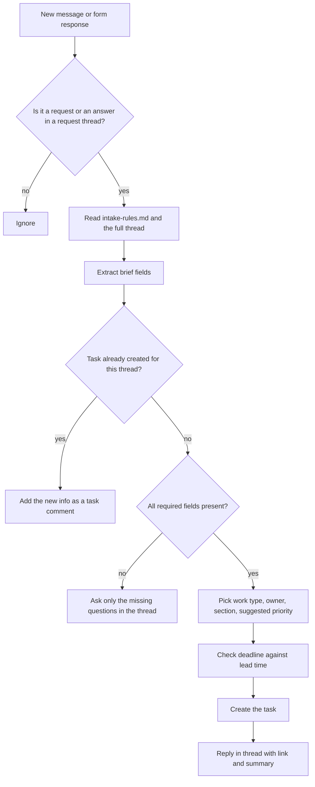

# Marketing request intake

> Turns messy requests to the marketing team ("can we get a banner for the launch?") into
> complete briefs. Asks the requester for what is missing, then creates one routed task.

| | |
|---|---|
| Key | `creative-request-intake` |
| Sector | Marketing (marketing operations, creative and content teams) |
| Card category | Marketing |
| Pattern | Inbound extractor |
| Trigger | A new message in the requests channel, or a new form response |
| Apps | Slack (required), Asana (required; Notion or Jira as options), Typeform (optional) |
| Score | 75 (Pain 3, Recurrence 5, Ease 5) |

## 1. The world this lives in

A marketing team gets requests from the whole company. Sales wants a one-pager. Product wants
a launch blog post. The CEO wants slides for a conference. Customer success wants an email
template. These requests arrive in Slack DMs, in meetings, and in random channels.

Each request is missing something: who it is for, what it must achieve, the deadline, the
size, or who approves it. The marketer asks follow-up questions, waits, asks again, and the
work starts late. Priorities change because nobody can see all requests in one place.

A **brief** fixes this. It is a short document that answers the questions before work starts.

Words you will see:

| Word | Meaning |
|---|---|
| Request | Something a person outside marketing asks the team to make. |
| Brief | The short spec of a request: goal, audience, deliverable, specs, deadline, approver. |
| Deliverable | The thing to make: a blog post, a banner, an email, a deck, a video. |
| Specs | Size, format, and length, for example "LinkedIn banner 1584x396 px, PNG". |
| Stakeholder / approver | The person who signs off the final work. |
| Intake | The process of collecting and checking requests before work starts. |
| Work type | The category that decides who does it: design, copy, content, web, events, video. |
| Project management tool | Where tasks live: Asana, Jira, Notion, Monday, ClickUp. |

## 2. The problem today

How teams handle it now:

1. A request lands in a DM or a channel.
2. The marketer asks five follow-up questions over two days.
3. The marketer copies the answers into Asana by hand and guesses the priority.
4. Requests that skip this step are forgotten or done in a rush.

Why it matters:

- Workers spend about 60% of their time on "work about work" such as chasing status and
  searching for information [Vv, Asana Anatomy of Work 2021, n=13,123].
- 58% of marketers go through five or more revision rounds per project, often because the
  brief was unclear [Vv, Workfront UK survey, sponsored].

## 3. What the agent does

When a new message lands in the requests channel (or a form response arrives):

1. It decides whether the message is a request. Chat and thank-you messages are ignored.
2. It extracts the brief fields from the message.
3. It scores how complete the brief is.
4. If fields are missing, it replies in the thread with only the missing questions, at most
   four.
5. When the requester answers, it extracts again.
6. When the brief is complete (or the requester says "that's all"), it creates one task in
   Asana with the full brief, the work type, the owner, and a suggested priority. It replies
   in the thread with the task link.

The agent does not do the creative work, does not promise a delivery date, and does not set
final priority. The marketing lead confirms priority.

## 4. Who installs it and who benefits

- **Installs it:** the marketing lead or marketing ops.
- **Uses it:** everyone who asks marketing for something. They post in one channel.
- **Benefits:** marketers get complete briefs and one queue.

## 5. Apps it uses

| Connection key | Required | Composio options | What the agent does with it | Candidate actions | Policy |
|---|---|---|---|---|---|
| `chat` | yes | `slack` | Read new messages and thread replies in the requests channel; reply in threads; look up the requester. | `SLACK_FETCH_CONVERSATION_HISTORY`, `SLACK_FETCH_MESSAGE_THREAD_FROM_A_CONVERSATION`, `SLACK_SEND_MESSAGE`, `SLACK_RETRIEVE_DETAILED_USER_INFORMATION` | allow these; deny the rest |
| `tasks` | yes | `asana`, `notion`, `jira` | Create one task (or page, or issue) with the brief; read the project's sections. | Asana: `ASANA_CREATE_A_TASK`, `ASANA_GET_SECTIONS_IN_A_PROJECT`. Notion: `NOTION_CREATE_NOTION_PAGE`. Jira: `JIRA_CREATE_ISSUE` | allow create and read; deny delete and update of other items |
| `form` | no | `typeform` | Read new form responses when the team uses a request form. | `TYPEFORM_GET_RESPONSES` | `allow_reads` |

## 6. Setup: what the user provides

Required (one form):

| Field | Why | Default |
|---|---|---|
| Requests channel | Where people post requests. | `#marketing-requests` |
| Task destination | The Asana project (or Notion database, Jira project). | none |
| Marketing lead | Confirms priority; gets the weekly queue summary. | the installer |

Researchable: the Asana project's sections (for example "Inbox", "Design", "Content"). The
builder agent reads them and maps work types to sections.

Seed files:

- `intake-rules.md`, edited by the user:

```markdown
## Brief fields
Required: deliverable, goal, audience, deadline, approver
Optional: specs (size/format/length), key message, links/assets, budget

## Work types and owners
design: @maria (sections: Design)
copy: @tom (Content)
blog/content: @tom (Content)
web page: @lee (Web)
event: @priya (Events)
other: @marketing-lead (Inbox)

## Lead times (minimum working days)
design small: 3 · design large: 10 · blog post: 7 · web page: 10 · event: 20

## Priority hints
P1: launch, revenue deal with a date, legal or security deadline
P2: campaign work with a date in the next 4 weeks
P3: everything else
```

## 7. Automations

| Key | Trigger | Detail | Message to the agent |
|---|---|---|---|
| `new-request` | subscription: Slack new message (candidate `SLACK_RECEIVE_MESSAGE`), `trigger_config` = requests channel | Fires on new messages and thread replies. | "Process the message in inputs.event as a marketing request." + `"event": "$.event.attributes"` |
| `form-response` | subscription: Typeform new response (candidate `TYPEFORM_NEW_RESPONSE`) | Optional, when a form is used. | "Process the form response in inputs.event as a marketing request." |
| `sweep` | schedule `0 * * * 1-5` | Fallback when no message trigger exists: reads the last hour of channel messages. Also finds threads where the requester did not answer for 2 working days and sends one reminder. | "Process new requests in the requests channel and remind requesters with open questions." |
| `weekly-queue` | schedule `0 8 * * 1` | Monday summary to the marketing lead. | "Post the weekly request queue summary." |

## 8. How one run works



Procedure for `AGENTS.md`:

1. Read `intake-rules.md`.
2. Read the message. If it is a thread reply, read the whole thread
   (`SLACK_FETCH_MESSAGE_THREAD_FROM_A_CONVERSATION`).
3. Classify the top message: `request`, `question` (someone asks how to request), or
   `other`. For `other`, stop. For `question`, reply once with how to post a request.
4. Ignore messages from bots, including your own.
5. Check whether this thread already has a task: look for your own earlier reply that
   contains a task link. If it does, add the new information as a comment on that task and
   stop.
6. Extract the brief fields from all human messages in the thread. Convert relative dates
   ("next Friday") to a real date with a script, using the message timestamp.
7. If any required field is missing and you have asked fewer than two times in this thread,
   reply with only the missing questions (at most four, numbered, short). Offer examples.
   Stop.
8. If the requester answered "that's all", "not sure", or you already asked twice, continue
   with what you have and mark missing fields as "Not provided".
9. Pick the work type from the deliverable. Look up the owner and section in the rules.
10. Compare the deadline with the lead time. If it is shorter, add a flag "Deadline is
    shorter than the usual lead time (3 vs 10 working days)".
11. Suggest a priority from the hints. Write it as "Suggested: P2".
12. Create the task (format in section 10), assign the owner, put it in the section, set the
    due date.
13. Reply in the thread: task link, owner, suggested priority, and any flags.

## 9. Decision rules

| Situation | Action |
|---|---|
| A message with a deliverable and a verb ("can we get", "need", "please make") | Treat as a request. |
| Several deliverables in one message ("a blog post and a banner") | One task per deliverable, linked; ask once for shared fields. |
| Deadline in the past or missing after two asks | Create the task with "Deadline: not set" and flag it. |
| Requester is in the marketing team | Still create the task; skip the questions if the brief is complete. |
| Request is for something marketing does not do (a bug report, a sales quote) | Reply with where to go instead (from `intake-rules.md` if listed), do not create a task. |

## 10. Outputs

Missing-field reply:

```
Thanks! To get this started I need 3 things:
1. Who is the audience? (e.g. existing customers, developers, CFOs)
2. What should it achieve? (e.g. sign-ups for the webinar)
3. Who approves the final version?
Deadline noted: Fri 24 Oct.
```

Task (Asana):

```
Title: [Design] LinkedIn banner for Q4 launch — due Fri 24 Oct
Requester: Sam Lee (Sales)
Deliverable: LinkedIn company page banner
Goal: Announce the Q4 launch and drive demo requests
Audience: Prospects in data teams
Specs: 1584x396 px, PNG; also a 1200x627 post image
Key message: "Evaluate your LLM apps in one place"
Links/assets: <launch brief doc>
Approver: Priya (PMM)
Suggested priority: P1 (launch)
Flags: none
Source thread: <Slack link>
```

Thread reply:

```
✅ Brief created: <task link> · Owner: @maria · Suggested priority: P1
The marketing lead will confirm priority.
```

Weekly queue (to the marketing lead): new requests by work type, tasks with flags, threads
waiting for requester answers.

## 11. Worked example

Sam posts: "Can we get a LinkedIn banner for the Q4 launch by next Friday? Need it for the
sales team." The agent extracts deliverable, deadline (converted to Fri 24 Oct), and a partial
audience. It asks for goal, audience details, and approver. Sam answers: "Prospects in data
teams, drive demo requests, Priya approves." The agent creates the Design task for Maria with
a P1 suggestion and replies with the link.

## 12. Guardrails

- The agent never promises a delivery date. It reports the deadline and flags risk.
- The agent never changes or deletes tasks other than the one it created for a thread.
- At most two rounds of questions per thread, so the agent is never a nag.
- Do not create a task from a message that is only a question or a joke.

## 13. Edge cases and failures

| Case | Handling |
|---|---|
| The message trigger fires on the agent's own reply | Step 4 ignores bot messages. |
| Requester replies in a new message, not in the thread | The next run reads recent messages from the same person; if one clearly answers your questions, link it. Else treat it as new. |
| Owner from the rules is not in Asana | Assign to the marketing lead and say so. |
| Asana create fails | Reply in the thread with the brief as text and "I could not create the task; @lead please add it". |
| Attachments (images, docs) | Copy their links into the task. Do not open or describe images. |

## 14. State and de-duplication

The Slack thread is the state. The agent's own reply holds the task link. Before creating a
task, the agent checks the thread for that link, so a second run never creates a second task.

## 15. Compute and cost

One thread read, one LLM pass to extract and decide, then one or two writes. Each run is small
(a few thousand tokens). The hourly sweep only reads the last hour of messages.

## 16. How to test it

1. `test_run` with a sample event: "Can we get a blog post about our new eval feature by end
   of month?" Expect a reply asking for audience, goal, and approver; no task.
2. `test_run` with the same thread plus answers. Expect one task in the right section with
   the right owner, and a thread reply with the link.
3. Run step 2 again. Expect a comment on the existing task, not a new task.
4. Turn on `new-request`; use Lightning "Test event", then post a real request in the channel.

## 17. Success metrics

- Share of requests that enter the queue through the channel.
- Average follow-up questions per request (goal: down as people learn the format).
- Time from request to task created.

## 18. Package sketch

```json
{
  "schema_version": 1,
  "entry": "creative-request-intake",
  "agents": {
    "creative-request-intake": {
      "name": "Marketing request intake",
      "description": "Turns requests to the marketing team into complete, routed briefs.",
      "instructions": "./ai.agenta/agents/creative-request-intake/AGENTS.md",
      "setup": "./ai.agenta/agents/creative-request-intake/SETUP.md",
      "connections": [
        { "key": "chat", "required": true, "purpose": "Read requests and reply in threads.",
          "options": [{ "kind": "gateway", "provider": "composio", "integration": "slack" }],
          "policy": { "permissions": { "default": "allow_reads", "tools": { "SLACK_SEND_MESSAGE": "allow" } } } },
        { "key": "tasks", "required": true, "purpose": "Create one task per brief.",
          "options": [
            { "kind": "gateway", "provider": "composio", "integration": "asana" },
            { "kind": "gateway", "provider": "composio", "integration": "notion" },
            { "kind": "gateway", "provider": "composio", "integration": "jira" } ],
          "policy": { "permissions": { "default": "allow_reads", "tools": {
            "ASANA_CREATE_A_TASK": "allow", "ASANA_CREATE_A_STORY_ON_A_TASK": "allow" } } } },
        { "key": "form", "required": false, "purpose": "Read request form responses.",
          "options": [{ "kind": "gateway", "provider": "composio", "integration": "typeform" }],
          "policy": { "permissions": { "default": "allow_reads", "tools": {} } } }
      ],
      "automations": [
        { "key": "new-request", "name": "New request message", "required": false,
          "trigger": { "type": "subscription", "connection": "chat", "event_key": "SLACK_RECEIVE_MESSAGE",
                       "trigger_config": { "channel": "<requests channel id>" } },
          "inputs_fields": { "messages": [{ "role": "user", "content": "Process the message in inputs.event as a marketing request." }],
                             "event": "$.event.attributes" } },
        { "key": "sweep", "name": "Hourly sweep and reminders", "required": false,
          "trigger": { "type": "schedule", "schedule": "0 * * * 1-5" },
          "inputs_fields": { "messages": [{ "role": "user", "content": "Process new requests in the requests channel and remind requesters with open questions." }] } },
        { "key": "weekly-queue", "name": "Weekly queue summary", "required": false,
          "trigger": { "type": "schedule", "schedule": "0 8 * * 1" },
          "inputs_fields": { "messages": [{ "role": "user", "content": "Post the weekly request queue summary." }] } }
      ],
      "workspace": { "entries": [
        { "type": "file", "source": "./ai.agenta/agents/creative-request-intake/files/intake-rules.md", "path": "intake-rules.md" }
      ] }
    }
  }
}
```

## 19. Catalog card

- Summary: "Turns messy marketing requests into complete briefs."
- Trigger label: "New request".
- Seed message: "Build an agent that reads requests in #marketing-requests, asks for missing
  details, and creates a complete brief task in Asana for the right owner."
- Example: prompt "Can we get a LinkedIn banner for the launch by Friday?" → steps "Asked for
  goal, audience and approver", "Built the brief", "Created a Design task for Maria" →
  status "Done".

## 20. Open questions

- Does the Composio Slack trigger fire for thread replies, or only top-level messages? If
  only top-level, the hourly sweep handles answers.
- Should the agent DM the requester instead of replying in the public thread? v1: thread, so
  the team sees context.
