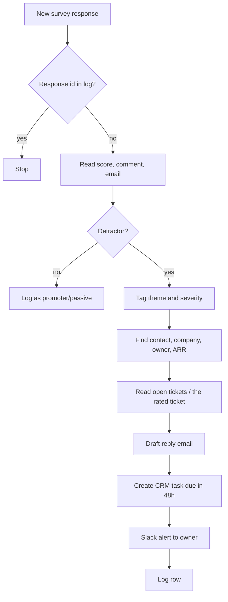

# Detractor close-the-loop

> When a customer gives a low score in an NPS or CSAT survey, tags what the complaint is
> about, collects the account context, drafts a reply for the account owner, and creates a
> follow-up task due in 48 hours.

| | |
|---|---|
| Key | `detractor-close-loop` |
| Sector | Customer Success (voice of the customer) |
| Card category | Customer Success |
| Pattern | Inbound extractor |
| Trigger | A new survey response; a schedule every 2 hours as fallback |
| Apps | Typeform or SurveyMonkey (required), Slack (required), HubSpot or Salesforce (optional), Zendesk or Intercom (optional), Gmail (optional), Google Sheets (required, for the log) |
| Score | 80 (Pain 4, Recurrence 4, Ease 5) |

## 1. The world this lives in

Software companies ask customers how they feel with short surveys:

- **NPS** (Net Promoter Score): "How likely are you to recommend us to a friend or colleague?"
  on a 0-10 scale. 9-10 are **promoters**, 7-8 are **passives**, 0-6 are **detractors**. NPS
  = % promoters − % detractors.
- **CSAT** (customer satisfaction): "How satisfied were you?" usually on a 1-5 scale, often
  sent after a support ticket closes. 1-2 is a bad score.

Most surveys include a comment box: "What is the main reason for your score?" That comment is
the most useful part. A detractor who explains their problem is telling you how they might
churn.

**Closing the loop** means replying to that person, fixing what you can, and telling them what
you did. Most companies collect scores and never reply.

Words you will see:

| Word | Meaning |
|---|---|
| NPS | Net Promoter Score survey, 0-10. |
| Detractor | NPS 0-6: an unhappy customer. |
| Passive | NPS 7-8. |
| Promoter | NPS 9-10: a happy customer. |
| CSAT | Customer satisfaction score, often 1-5. |
| Verbatim | The free-text comment in a survey response. |
| Theme | The topic of a complaint: bugs, missing feature, price, support, onboarding, performance. |
| Close the loop | Reply to the respondent, act, and report back. |
| Inner loop / outer loop | Inner: fix this one customer's issue. Outer: feed the theme to product. |

## 2. The problem today

How teams handle it now:

1. Survey responses land in Typeform or SurveyMonkey and in a dashboard.
2. Someone reads them weekly, if at all.
3. A few detractors get a reply days later; most get none.

Why it matters:

- Among companies with top NPS scores, 61% follow up with detractors within 48 hours. Among
  companies with low scores, 34% do [V, Bain & Company].
- A detractor with a reply in 48 hours sees the company listens. A detractor with no reply has
  one more reason to leave.

## 3. What the agent does

When a new survey response arrives:

1. Reads the score, the comment, and who responded.
2. Ignores promoters and passives (it logs them for counts).
3. For detractors (NPS 0-6, or CSAT 1-2): tags the theme and severity from the comment.
4. Finds the account: company, owner, ARR, plan, open tickets.
5. Drafts a reply that names the customer's actual problem, does not promise anything, and
   offers a short call.
6. Creates a follow-up task for the owner, due in 48 hours, in the CRM.
7. Alerts the owner in Slack with everything in one message.
8. Once a week, posts theme counts for the product team (the outer loop).

The agent never sends the reply, never offers discounts, and never promises features or dates.

## 4. Who installs it and who benefits

- **Installs it:** the head of CS, a CX or customer insights lead, or the founder.
- **Gets alerts:** account owners (CSMs); support leads for CSAT detractors.
- **Benefits:** customers who complained; the product team (theme digest).

## 5. Apps it uses

| Connection key | Required | Composio options | What the agent does with it | Candidate actions | Policy |
|---|---|---|---|---|---|
| `survey` | yes | `typeform`, `survey_monkey` (Delighted: verify) | Receive or list new responses; read score, comment, email, hidden fields. | `TYPEFORM_GET_RESPONSES`; SurveyMonkey "get survey responses" | `allow_reads` |
| `crm` | no | `hubspot`, `salesforce` | Find contact and company; read owner, ARR, plan; create the follow-up task. | `HUBSPOT_SEARCH_CONTACTS`, `HUBSPOT_GET_COMPANY`, `HUBSPOT_CREATE_TASK` (candidate) | `allow_reads` + allow task create |
| `support` | no | `zendesk`, `intercom` | List the account's open tickets and the ticket a CSAT response refers to. | `ZENDESK_SEARCH`, `ZENDESK_GET_TICKET` | `allow_reads` |
| `chat` | yes | `slack` | Alert the owner; post the weekly theme digest. | `SLACK_SEND_MESSAGE`, `SLACK_LOOKUP_USER_BY_EMAIL` | allow these; deny the rest |
| `email` | no | `gmail` | Create the reply draft in the shared CS mailbox. | `GMAIL_CREATE_EMAIL_DRAFT` | allow draft; deny send |
| `log` | yes | `googlesheets` | One row per response; theme counts. | `GOOGLESHEETS_GET_VALUES`, `GOOGLESHEETS_APPEND_VALUES` | allow |

## 6. Setup: what the user provides

Required (one form):

| Field | Why | Default |
|---|---|---|
| The survey | Which Typeform form or SurveyMonkey survey to watch. | none |
| Survey type | Sets the detractor threshold. | NPS (0-6 is a detractor) |
| Fallback owner | Gets alerts when the CRM has no owner. | the installer |
| Theme digest channel | Weekly outer-loop summary. | `#product-feedback` |

Researchable:

- Which survey field holds the score, the comment, and the email. Typeform forms often pass
  the email as a hidden field (`hidden.email`). The builder agent reads one sample response.
- For CSAT after support tickets: which hidden field holds the ticket id.

Seed files:

- `close-loop-rules.md`:

```markdown
## Detractor thresholds
NPS: 0-6 · CSAT (1-5): 1-2

## Themes
bug / reliability · missing feature · performance · pricing / value · support experience ·
onboarding / ease of use · billing · other

## Severity
high: mentions cancelling, switching, a competitor, data loss, security, or legal
medium: blocked from a key task, repeated problem
low: annoyance, cosmetic

## Reply rules
- Thank them and restate their exact point in one sentence.
- No promises of features, dates, refunds or discounts.
- Offer a 15-minute call with a booking link: <link>
- Under 120 words. Sign as the account owner.
```

Log sheet tab `survey-responses`, columns:

`response_id | submitted_at | email | company | score | type | theme | severity | owner | task_id | alert_ts | status`

## 7. Automations

| Key | Trigger | Detail | Message to the agent |
|---|---|---|---|
| `new-response` | subscription: Typeform new response (candidate `TYPEFORM_NEW_RESPONSE`) with `trigger_config` = form id | One run per response. | "Handle the survey response in inputs.event." + `"event": "$.event.attributes"` |
| `sweep` | schedule `0 */2 * * *` | Fallback: lists responses from the last 2 hours not in the log. Also needed for SurveyMonkey if no trigger exists. | "Handle every new survey response since the last run." |
| `weekly-themes` | schedule `0 8 * * 1` | Outer loop: theme counts and example quotes. | "Post the weekly survey theme digest." |

## 8. How one run works



Procedure for `AGENTS.md`:

1. Read `close-loop-rules.md`.
2. Read the response. Get `response_id`, `submitted_at`, score, comment, email, and hidden
   fields.
3. If the `response_id` is in the log, stop.
4. If the score is not in the detractor range, append a log row with the type and stop.
5. Tag one theme and one severity. If the comment is empty, set theme `other`, severity by
   score (0-3 high, 4-6 medium).
6. Find the contact by email in the CRM, then the company, owner, ARR, and plan. If there is
   no match, use the email domain to find the company; else use the fallback owner.
7. Read open tickets for the company. For a CSAT response with a ticket id, read that ticket.
8. Write the reply draft by the reply rules. Quote or restate the customer's point; if a
   related open ticket exists, mention that the team is working on it, without dates.
9. Create a Gmail draft to the respondent (if the email connection exists).
10. Create a CRM task for the owner: "Close the loop with <name> (NPS 3)", due 48 hours after
    `submitted_at`, with the comment and draft in the body.
11. DM the owner in Slack (section 10). For severity high, also post in the CS lead's channel.
12. Append the log row with `status = open`.

Weekly themes: count detractor themes for the last 7 days, compare with the week before,
include two short quotes per top theme (no names or emails), and post to the digest channel.

## 9. Decision rules

| Situation | Action |
|---|---|
| NPS 0-6 or CSAT 1-2 | Full close-the-loop flow. |
| NPS 7-8 with a comment that mentions a problem | Log; include in the weekly digest only. |
| Promoter (9-10) | Log only. (A later template can ask promoters for a public review.) |
| Severity high | Also alert the CS lead. |
| Same person, second detractor response in 30 days | Mention "Second low score in 30 days" in the alert. |
| Respondent is not a customer (no CRM match, free email domain) | Alert the fallback owner, no CRM task. |
| Comment contains a security or data-loss report | Severity high; tell the owner to open a support ticket. |

## 10. Outputs

Owner Slack DM:

```
🙁 NPS 3 from Dana Ruiz (Acme Corp · $28.8k ARR · renews 2 Nov)
"The new dashboard is very slow and our team stopped using it."
Theme: performance · Severity: medium
Open tickets: #4821 "Dashboard loads > 20s" (open 6 days)
✉️ Reply draft ready in cs@ · ✅ Task "Close the loop with Dana" due Thu 16 Oct 14:20
```

Reply draft:

```
Subject: Thanks for your feedback, Dana

Hi Dana,

Thank you for telling us the new dashboard is slow for your team. That isn't the experience we
want for you. Our support team is already looking at it in ticket #4821.

Could we take 15 minutes this week so I can understand where it slows you down?
<booking link>

Sam
```

Weekly theme digest:

```
Survey themes · last 7 days · 41 responses · NPS 32 (prev 36)
Detractors: 9 · Top themes: performance 4 (↑3), missing feature 2, support 2
"Dashboard takes forever to load" · "Exports time out on large projects"
```

## 11. Worked example

Dana submits NPS 3 with the comment above. The agent tags performance / medium, finds Acme
Corp in HubSpot (owner Sam, ARR $28.8k), sees ticket #4821 open, writes the draft, creates the
task due in 48 hours, and DMs Sam. Sam edits the draft and sends it. The weekly digest shows
performance as the rising theme.

## 12. Guardrails

- The agent never sends the reply. Drafts only.
- No promises: no dates, features, refunds, or discounts in any draft.
- The weekly digest never shows names or emails.
- The agent does not change survey data or CRM fields; it only creates tasks.

## 13. Edge cases and failures

| Case | Handling |
|---|---|
| Comment in another language | Tag the theme from the comment; write the draft in the same language. |
| Abusive comment | Severity high; no draft; alert the owner to handle it personally. |
| Anonymous survey (no email) | Log and include in the digest; no reply possible. |
| CRM task creation fails | Put the due date in the Slack alert and say the task was not created. |
| The trigger fires and the sweep also finds it | The log check on `response_id` stops the second run. |

## 14. State and de-duplication

The log sheet keyed by `response_id`. The weekly digest reads the log, not the survey tool, so
it is cheap.

## 15. Compute and cost

One response read, one or two CRM reads, one support read, one LLM pass (tag + draft), and
three writes. About 3-5k tokens per detractor; promoters and passives cost almost nothing.

## 16. How to test it

1. Submit a test response to the form: score 3, comment "Exports keep failing", email of a
   test contact in the CRM.
2. `test_run` with "Handle the survey response in inputs.event." and that response. Expect
   the theme "bug / reliability", a draft, a task due in 48 hours, and a DM.
3. Run it again. Expect no new draft or task.
4. Submit a score 10. Expect only a log row.
5. Turn on `new-response`; use Lightning "Test event".

## 17. Success metrics

- Share of detractors with a reply within 48 hours (goal: above 80%).
- Detractor-to-passive or promoter conversion at the next survey.
- Renewal rate of accounts with a detractor who got a reply versus none.

## 18. Package sketch

```json
{
  "schema_version": 1,
  "entry": "detractor-close-loop",
  "agents": {
    "detractor-close-loop": {
      "name": "Detractor close-the-loop",
      "description": "Drafts a reply and creates a 48-hour follow-up when a customer gives a low survey score.",
      "instructions": "./ai.agenta/agents/detractor-close-loop/AGENTS.md",
      "setup": "./ai.agenta/agents/detractor-close-loop/SETUP.md",
      "connections": [
        { "key": "survey", "required": true, "purpose": "Read new survey responses.",
          "options": [
            { "kind": "gateway", "provider": "composio", "integration": "typeform" },
            { "kind": "gateway", "provider": "composio", "integration": "survey_monkey" } ],
          "policy": { "permissions": { "default": "allow_reads", "tools": {} } } },
        { "key": "crm", "required": false, "purpose": "Find the account and create the follow-up task.",
          "options": [
            { "kind": "gateway", "provider": "composio", "integration": "hubspot" },
            { "kind": "gateway", "provider": "composio", "integration": "salesforce" } ],
          "policy": { "permissions": { "default": "allow_reads", "tools": { "HUBSPOT_CREATE_TASK": "allow" } } } },
        { "key": "support", "required": false, "purpose": "Read the account's open tickets.",
          "options": [
            { "kind": "gateway", "provider": "composio", "integration": "zendesk" },
            { "kind": "gateway", "provider": "composio", "integration": "intercom" } ],
          "policy": { "permissions": { "default": "allow_reads", "tools": {} } } },
        { "key": "chat", "required": true, "purpose": "Alert the owner and post the theme digest.",
          "options": [{ "kind": "gateway", "provider": "composio", "integration": "slack" }],
          "policy": { "permissions": { "default": "deny", "tools": {
            "SLACK_SEND_MESSAGE": "allow", "SLACK_LOOKUP_USER_BY_EMAIL": "allow" } } } },
        { "key": "email", "required": false, "purpose": "Create the reply draft.",
          "options": [{ "kind": "gateway", "provider": "composio", "integration": "gmail" }],
          "policy": { "permissions": { "default": "deny", "tools": { "GMAIL_CREATE_EMAIL_DRAFT": "allow" } } } },
        { "key": "log", "required": true, "purpose": "Track each response once.",
          "options": [{ "kind": "gateway", "provider": "composio", "integration": "googlesheets" }],
          "policy": { "permissions": { "default": "allow", "tools": {} } } }
      ],
      "automations": [
        { "key": "new-response", "name": "New survey response", "required": false,
          "trigger": { "type": "subscription", "connection": "survey", "event_key": "TYPEFORM_NEW_RESPONSE",
                       "trigger_config": { "form_id": "<form id>" } },
          "inputs_fields": { "messages": [{ "role": "user", "content": "Handle the survey response in inputs.event." }],
                             "event": "$.event.attributes" } },
        { "key": "sweep", "name": "Two-hour sweep", "required": false,
          "trigger": { "type": "schedule", "schedule": "0 */2 * * *" },
          "inputs_fields": { "messages": [{ "role": "user", "content": "Handle every new survey response since the last run." }] } },
        { "key": "weekly-themes", "name": "Weekly theme digest", "required": false,
          "trigger": { "type": "schedule", "schedule": "0 8 * * 1" },
          "inputs_fields": { "messages": [{ "role": "user", "content": "Post the weekly survey theme digest." }] } }
      ],
      "workspace": { "entries": [
        { "type": "file", "source": "./ai.agenta/agents/detractor-close-loop/files/close-loop-rules.md", "path": "close-loop-rules.md" }
      ] }
    }
  }
}
```

## 19. Catalog card

- Summary: "Replies to unhappy survey responses within 48 hours."
- Trigger label: "New survey response".
- Seed message: "Build an agent that, when someone gives us an NPS score of 6 or lower in
  Typeform, tags the reason, drafts a reply for the account owner, and creates a follow-up
  task in HubSpot due in 48 hours."
- Example: prompt "NPS 3: 'The new dashboard is very slow'" → steps "Tagged performance,
  medium", "Found Acme Corp and open ticket #4821", "Drafted a reply and a 48h task" →
  status "Awaiting approval".

## 20. Open questions

- Confirm the Typeform trigger slug and whether its payload includes hidden fields.
- Confirm a HubSpot "create task" action exists in Composio; else use an engagement/note.
- Delighted support in Composio is not confirmed; add it when verified.
