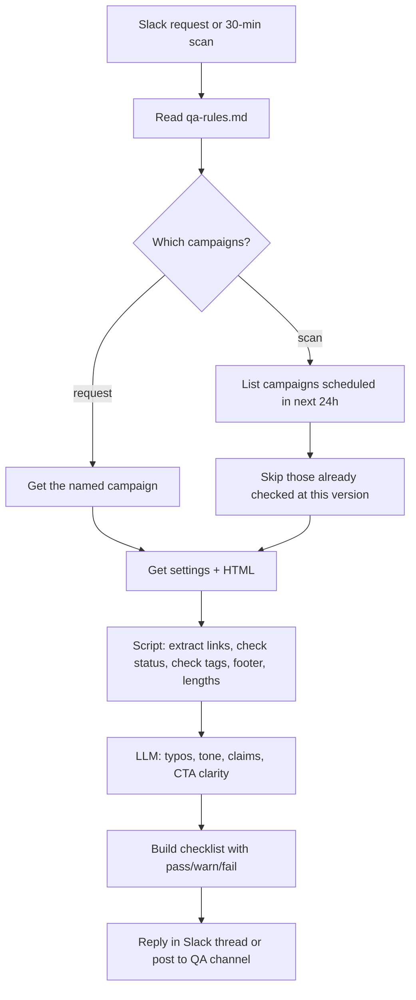

# Pre-send email QA

> Checks a marketing email before it goes out: broken or wrong links, bad personalization
> tags, a missing unsubscribe link, a weak subject line, typos, and risky claims. Gives a
> pass/fail checklist to the person who sends it.

| | |
|---|---|
| Key | `email-preflight-qa` |
| Sector | Marketing (lifecycle and email marketing) |
| Card category | Marketing |
| Pattern | Inbound extractor (check one item, return a verdict) |
| Trigger | A Slack mention with a campaign link, plus a scan of scheduled campaigns every 30 minutes |
| Apps | One email platform: Mailchimp or Klaviyo in v1 (required); Slack (required) |
| Score | 80 (Pain 4, Recurrence 5, Ease 4) |

## 1. The world this lives in

Software companies send many marketing emails: product launches, newsletters, onboarding
series, webinar invites. The **lifecycle** or **email marketer** builds each one in an email
service provider (ESP) such as Mailchimp, Klaviyo, HubSpot, or Customer.io.

Once an email is sent to 50,000 people, it cannot be taken back. A broken link, a "Hi
{{first_name}}" that shows up as raw code, or a link to a staging site is public and
embarrassing. Teams check emails by hand before every send. It is slow and people still miss
things.

Words you will see:

| Word | Meaning |
|---|---|
| ESP | Email service provider: the tool that sends marketing email (Mailchimp, Klaviyo, ...). |
| Campaign | One email sent to a list or segment at a time. |
| Flow / automation | A series of emails sent when a person does something (signs up, abandons a cart). |
| Merge tag / personalization token | A placeholder that the ESP fills per person, such as `*|FNAME|*` (Mailchimp) or `{{ first_name }}` (Klaviyo). |
| Fallback | The default value when a merge field is empty: "Hi there" instead of "Hi ". |
| Preheader | The short preview text shown after the subject line in the inbox. |
| Unsubscribe link | A link every marketing email must have by law (CAN-SPAM in the US, GDPR/PECR in Europe). |
| Physical address | CAN-SPAM requires a postal address in commercial emails. |
| Seed / test send | A test copy sent to the team before the real send. |
| Staging URL | A link to an internal test website, for example `staging.example.com`. It must never reach customers. |

## 2. The problem today

How teams handle it now:

1. The marketer sends a test email to themselves and one colleague.
2. They click every link by hand, read the copy, and check the subject on a phone.
3. A manager approves in Slack: "LGTM".
4. On deadline days, steps 1-3 are skipped.

Why it matters:

- About 54% of marketers spend an hour or more testing and fixing each email [Vv, Litmus,
  older workflow research].
- Every send is public. A broken link costs clicks; a missing unsubscribe link is a legal
  risk.

## 3. What the agent does

When someone asks in Slack ("@agent check campaign <link>"), or when a campaign gets
scheduled, the agent:

1. Fetches the campaign: subject, preheader, sender, audience, and HTML body.
2. Runs mechanical checks with a script: link extraction, link status codes, merge-tag
   syntax, required footer parts, subject and preheader length.
3. Runs one LLM pass for language checks: typos, tone, unclear calls to action, and risky
   claims ("guaranteed", "free forever", unreleased features).
4. Replies with a checklist: each check is ✅ pass, ⚠️ warning, or ❌ fail, with the exact
   place to fix.

The agent never edits, schedules, unschedules, or sends a campaign.

## 4. Who installs it and who benefits

- **Installs it:** the lifecycle or email marketer, or marketing ops.
- **Uses it:** anyone who sends campaigns. The approver reads the checklist instead of
  re-checking everything.

## 5. Apps it uses

| Connection key | Required | Composio options | What the agent does with it | Candidate actions | Policy |
|---|---|---|---|---|---|
| `email-platform` | yes | `mailchimp`, `klaviyo` (v1); `hubspot`, `customerio` later | List scheduled campaigns; read one campaign's settings and HTML content. | Mailchimp: `MAILCHIMP_LIST_CAMPAIGNS`, `MAILCHIMP_GET_CAMPAIGN_INFO`, `MAILCHIMP_GET_CAMPAIGN_CONTENT`. Klaviyo: `KLAVIYO_GET_CAMPAIGNS`, `KLAVIYO_GET_CAMPAIGN_MESSAGE`, `KLAVIYO_GET_TEMPLATE` | `allow_reads`; deny all writes (no send, schedule, or edit) |
| `chat` | yes | `slack` | Receive the request; reply in the thread with the checklist. | `SLACK_SEND_MESSAGE` | allow this one; deny the rest |

Why Mailchimp and Klaviyo first: both have large confirmed Composio toolkits (272 and 225
tools) with campaign content reads. HubSpot marketing-email content and Customer.io message
content reads are not confirmed; add them in a later version.

## 6. Setup: what the user provides

Required (one form):

| Field | Why | Default |
|---|---|---|
| Email platform | Picks the connection and the merge-tag syntax. | Mailchimp |
| QA channel | Where scheduled-campaign checks are posted. | `#email-qa` |
| Company domains | Links to these domains are "ours"; anything else is flagged for review only if it is unusual. | the domain of the sender email |

Seed files:

- `qa-rules.md`, edited by the user:
  - `blocked_link_patterns`: `staging.`, `localhost`, `dev.`, `preview.`, `example.com`
  - `required_footer`: unsubscribe link, postal address, company name
  - `subject_max_chars`: `60`; `preheader_max_chars`: `110`
  - `banned_claims`: "guaranteed", "free forever", "no risk", "#1" (without a source)
  - `known_merge_fields`: the list of fields that exist, for example `FNAME`, `LNAME`,
    `COMPANY` (Mailchimp) or `first_name`, `company` (Klaviyo)
  - `brand_terms`: correct spellings of product names, for example "Agenta", not "agenta"

## 7. Automations

| Key | Trigger | Detail | Message to the agent |
|---|---|---|---|
| `slack-request` | subscription: Slack new message (candidate `SLACK_RECEIVE_MESSAGE`), `trigger_config` = the QA channel | Fires on messages in the QA channel. The agent acts only when the message contains a campaign link or id. | "Check the campaign named in inputs.event." with `"event": "$.event.attributes"` |
| `scheduled-scan` | schedule | `*/30 * * * *` | "Check every campaign scheduled to send in the next 24 hours that has no QA result yet." |

If a Slack message trigger is not available, the user can run the agent from the Agenta chat
with the campaign link. The scheduled scan works on its own.

## 8. How one run works



Procedure for `AGENTS.md`:

1. Read `qa-rules.md`.
2. Find the campaigns to check:
   - Request: parse the campaign id or URL from the message.
   - Scan: list campaigns with status "scheduled" and a send time in the next 24 hours.
     Skip a campaign when the QA channel already has a result for the same campaign id and
     the same content hash (see section 14).
3. For each campaign, read the settings (subject, preheader, from name, from email, reply-to,
   audience, send time) and the HTML content.
4. Save the HTML to a working file and run the check script (`bash` + a short Python
   snippet):
   - Extract every `href`. Resolve tracking redirects only if the ESP exposes the original
     URL; else check the URL as written.
   - For each unique URL, send one HEAD request (fall back to GET with a small byte range),
     with a 5-second timeout, at most 60 URLs. Record the final status code.
   - Flag URLs that match `blocked_link_patterns`, use `http://`, or are empty (`href="#"`).
   - Find merge tags with the platform's syntax. Flag unknown fields, broken syntax (a
     missing closing brace), and tags with no fallback in the greeting.
   - Check that the footer has an unsubscribe link and a postal address.
   - Check subject and preheader length, and that the preheader is not empty.
   - Check that every image has `alt` text.
5. Send the visible text (HTML stripped) plus the subject and preheader to one LLM pass. Ask
   for: spelling and grammar errors, wrong brand terms, banned or risky claims, a missing or
   unclear call to action, and dates or prices that look inconsistent. Each finding must
   quote the exact text.
6. Build the checklist (section 10). The overall verdict is ❌ if any fail exists, ⚠️ if only
   warnings exist, ✅ otherwise.
7. Post the checklist: in the request thread, or in the QA channel for scan results. Include
   the campaign name, send time, and the content hash.

## 9. Decision rules

| Check | Fail | Warning |
|---|---|---|
| Link status | 4xx or 5xx, timeout, DNS error | 3xx to a different domain |
| Blocked pattern | Any match (staging, localhost) | — |
| Insecure link | — | `http://` |
| Empty link | `href=""` or `#` on a button | — |
| Merge tag | Unknown field or broken syntax | Greeting tag with no fallback |
| Unsubscribe | Missing | — |
| Postal address | Missing | — |
| Subject | Empty | Longer than the limit; ALL CAPS words; more than one "!" |
| Preheader | — | Empty or longer than the limit |
| Image alt | — | Missing alt text |
| Banned claim | Exact banned phrase | A "risky" claim the LLM flags |
| Typos / brand terms | — | Each finding |

## 10. Outputs

```
Email QA · "October product update" · scheduled Thu 16 Oct 15:00 UTC · to "All customers" (48,210)
Verdict: ❌ 2 fails, 3 warnings

❌ Broken link: "Read the docs" → https://docs.example.com/new-api (404)
❌ Staging link: "See pricing" → https://staging.example.com/pricing
⚠️ Greeting has no fallback: "Hi *|FNAME|*," → use *|FNAME:there|* or similar
⚠️ Preheader is empty
⚠️ Typo: "recieve" → "receive" (paragraph 3)

✅ 14 other links OK · ✅ unsubscribe · ✅ postal address · ✅ subject 48 chars · ✅ alt text
Content hash: 9f2c1e · Checked 14:12 UTC
```

## 11. Worked example

A marketer posts "@agent check https://us1.admin.mailchimp.com/campaigns/edit?id=123456" in
#email-qa. The agent reads campaign 123456, finds 16 links, gets a 404 on one docs link,
matches `staging.` on the pricing button, sees `*|FNAME|*` with no fallback, and finds one
typo. It replies in the thread with the checklist above. The marketer fixes the links and
asks again; the second result is ✅ with one warning.

## 12. Guardrails

- Read-only on the ESP: never send, schedule, unschedule, or edit.
- Do not test-send to any address.
- Do not follow links that look like unsubscribe or one-click actions with GET requests that
  could change state; use HEAD only for those, and skip `mailto:` and `tel:`.
- Do not paste the audience's personal data into Slack. Show only counts.

## 13. Edge cases and failures

| Case | Handling |
|---|---|
| Runner has no internet access for link checks | Mark link status as "not checked" (warning) and still run every other check. Say so in the verdict. |
| A site blocks HEAD requests (405) | Retry with a GET for the first 1 KB. |
| Tracking links hide the destination | Report the tracking domain as checked, and say the destination could not be confirmed. |
| More than 60 unique links | Check the first 60, warn about the rest. |
| Campaign not found | Reply "I can't find campaign X in <platform>. Check the link or my connection." |
| Klaviyo template uses Django-style logic (``) | Check tag syntax only; do not judge the logic. |

## 14. State and de-duplication

The scan must not post the same result every 30 minutes. The agent computes a short hash of
the subject, preheader, and HTML. Before posting a scan result, it reads the QA channel's
recent messages (last 48 hours) and skips a campaign whose id and hash already appear. A
changed email gets a new hash and a new check. No external sheet is needed.

## 15. Compute and cost

One or two ESP reads, a script with up to 60 small HTTP requests, and one LLM pass over the
visible text (usually 1-3k tokens). The scan does nothing when no campaign is scheduled.

## 16. How to test it

1. Build a test campaign with: one 404 link, one `staging.` link, an unknown merge tag, no
   preheader, and a typo. Schedule it for tomorrow in a test audience.
2. `test_run` with "Check campaign <id>." Expect ❌ with exactly those findings.
3. Fix everything and run again. Expect ✅.
4. Turn on `scheduled-scan`; use Play "Run". Expect one post; run again and expect no
   duplicate.

## 17. Success metrics

- Campaigns checked before send (share of all sends).
- Fails caught per month.
- Errors reported after send (goal: zero).

## 18. Package sketch

```json
{
  "schema_version": 1,
  "entry": "email-preflight-qa",
  "agents": {
    "email-preflight-qa": {
      "name": "Pre-send email QA",
      "description": "Checks a marketing email for broken links, bad merge tags and missing parts before it is sent.",
      "instructions": "./ai.agenta/agents/email-preflight-qa/AGENTS.md",
      "setup": "./ai.agenta/agents/email-preflight-qa/SETUP.md",
      "connections": [
        { "key": "email-platform", "required": true, "purpose": "Read scheduled campaigns and their content.",
          "options": [
            { "kind": "gateway", "provider": "composio", "integration": "mailchimp" },
            { "kind": "gateway", "provider": "composio", "integration": "klaviyo" } ],
          "policy": { "permissions": { "default": "allow_reads", "tools": {} } },
          "setup_notes": "Read access is enough. The agent never sends or edits campaigns." },
        { "key": "chat", "required": true, "purpose": "Receive requests and post QA results.",
          "options": [{ "kind": "gateway", "provider": "composio", "integration": "slack" }],
          "policy": { "permissions": { "default": "deny", "tools": { "SLACK_SEND_MESSAGE": "allow" } } } }
      ],
      "automations": [
        { "key": "slack-request", "name": "Check on request", "required": false,
          "trigger": { "type": "subscription", "connection": "chat", "event_key": "SLACK_RECEIVE_MESSAGE",
                       "trigger_config": { "channel": "<qa channel id>" } },
          "inputs_fields": { "messages": [{ "role": "user", "content": "Check the campaign named in inputs.event." }],
                             "event": "$.event.attributes" },
          "setup_notes": "Pick the QA channel. Verify the trigger slug with discover_triggers." },
        { "key": "scheduled-scan", "name": "Scan scheduled campaigns", "required": false,
          "trigger": { "type": "schedule", "schedule": "*/30 * * * *" },
          "inputs_fields": { "messages": [{ "role": "user", "content": "Check every campaign scheduled to send in the next 24 hours that has no QA result yet." }] } }
      ],
      "workspace": { "entries": [
        { "type": "file", "source": "./ai.agenta/agents/email-preflight-qa/files/qa-rules.md", "path": "qa-rules.md" }
      ] }
    }
  }
}
```

## 19. Catalog card

- Summary: "Catches broken links and bad merge tags before you send."
- Trigger label: "On request or before send".
- Seed message: "Build an agent that checks our Mailchimp campaigns for broken links, merge
  tag errors and a missing unsubscribe link before they go out, and posts the results in
  Slack."
- Example: prompt "Check the October product update" → steps "Read the campaign and 16
  links", "Found a 404 and a staging link", "Posted a checklist in the thread" → status "Done".

## 20. Open questions

- Does the agent runner allow outbound HTTP for link checks? If not, link status becomes a
  warning-only check until it does.
- Which Composio Slack trigger delivers channel messages, and does it include thread ids?
- HubSpot marketing email content read: confirm before adding HubSpot as an option.
