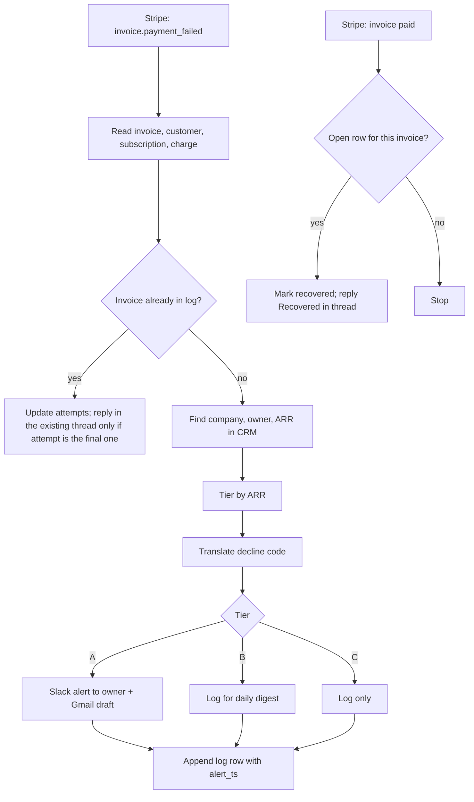

# Failed payment rescue

> When a customer's payment fails in Stripe, works out how much the account is worth and why
> the card failed. For valuable accounts it alerts the account owner in Slack and drafts a
> personal email. When the payment recovers, it closes the alert.

| | |
|---|---|
| Key | `failed-payment-rescue` |
| Sector | Customer Success (also Finance and RevOps) |
| Card category | Customer Success |
| Pattern | Inbound extractor (one event, one decision, one draft) |
| Trigger | Stripe event "invoice payment failed", plus "invoice paid"; daily schedule as fallback |
| Apps | Stripe (required), Slack (required), HubSpot or Salesforce (optional), Gmail (optional), Google Sheets (required, for the log) |
| Score | 125 (Pain 5, Recurrence 5, Ease 5) |

## 1. The world this lives in

Most software companies sell **subscriptions**: the customer pays every month or every year.
The company counts its income as **MRR** (monthly recurring revenue) or **ARR** (annual
recurring revenue).

When a customer leaves, that is **churn**. Some churn is a decision ("we picked a competitor").
A large part is an accident: the card expired, the bank declined a big charge, or the person
who owned the card left the company. This is **involuntary churn**. The customer did not
decide to leave; the payment just failed and nobody fixed it.

Stripe, the payment system, already retries failed payments and can send automatic emails.
This process is called **dunning**. But automatic emails are generic, go to a billing address
nobody reads, and nobody on the customer team knows a key account is about to lapse.

Words you will see:

| Word | Meaning |
|---|---|
| MRR / ARR | Monthly / annual recurring revenue from subscriptions. |
| Churn | Customers or revenue lost in a period. |
| Involuntary churn | Churn caused by failed payments, not by a decision. |
| Dunning | The process of retrying a failed payment and reminding the customer. |
| Invoice | Stripe's bill for one period of a subscription. |
| `invoice.payment_failed` | The Stripe event sent when a payment attempt for an invoice fails. |
| Decline code | The reason the bank gave, for example `insufficient_funds`, `expired_card`, `do_not_honor`. |
| Smart Retries | Stripe's automatic retry schedule. |
| `attempt_count` | How many times Stripe has tried this invoice. |
| `next_payment_attempt` | When Stripe will try again. |
| Hosted invoice page | A Stripe link where the customer can pay or update their card. |
| Account owner / CSM | Customer success manager: the person responsible for a customer account. |
| Tier | A group of accounts by value, for example Tier A = ARR of $10k or more. |

## 2. The problem today

How teams handle it now:

1. Stripe retries and sends a generic email to the billing contact.
2. Finance sees failed payments in a weekly report, if anyone looks.
3. The CSM learns about it when the subscription is cancelled at the end of the retry period.

Why it matters:

- Failed payments cause 16-40% of all churn, depending on the business [Vv, Churnkey on Stripe
  data: 16% B2B, 24% B2C; Paddle: 20-40%].
- About 70% of failed payments can be recovered, and 61% of recoveries happen in the first 7
  days [Vv, Churnkey]. Speed matters.

## 3. What the agent does

When Stripe reports a failed invoice payment:

1. Reads the invoice, the customer, the subscription, and the failed charge.
2. Finds the account in the CRM: company, owner, ARR. If there is no CRM, it uses the Stripe
   subscription amount and a default owner.
3. Puts the account in a tier and reads the decline reason in plain words.
4. Tier A: posts a Slack alert to the owner and creates a Gmail draft (from the owner, to the
   customer's main contact) with the payment link.
5. Tier B: adds it to a daily Slack digest.
6. Tier C: only logs it; Stripe's own dunning handles it.
7. When Stripe reports that the invoice is paid, it marks the log row recovered and replies
   in the alert thread: "Recovered ✅".

The agent never retries a charge, never changes a subscription, never gives a discount, and
never sends the email itself.

## 4. Who installs it and who benefits

- **Installs it:** the head of customer success, RevOps, or the founder.
- **Gets alerts:** account owners (CSMs or account executives).
- **Benefits:** finance (more revenue recovered) and CS (no surprise churn).

## 5. Apps it uses

| Connection key | Required | Composio options | What the agent does with it | Candidate actions | Policy |
|---|---|---|---|---|---|
| `billing` | yes | `stripe` | Receive payment events; read invoice, customer, subscription, charge, and the hosted invoice link. | `STRIPE_RETRIEVE_INVOICE`, `STRIPE_RETRIEVE_CUSTOMER`, `STRIPE_RETRIEVE_SUBSCRIPTION`, `STRIPE_RETRIEVE_CHARGE`, `STRIPE_LIST_INVOICES` | `allow_reads`; **deny** every write (no refunds, retries, coupons, cancellations) |
| `crm` | no | `hubspot`, `salesforce` | Find the company by Stripe customer id or email domain; read owner and ARR. | `HUBSPOT_SEARCH_COMPANIES`, `HUBSPOT_LIST_OWNERS`; Salesforce SOQL query | `allow_reads` |
| `chat` | yes | `slack` | Alert the owner; post the daily digest; reply when recovered. | `SLACK_LOOKUP_USER_BY_EMAIL`, `SLACK_SEND_MESSAGE` | allow these; deny the rest |
| `email` | no | `gmail` | Create a draft in the owner's mailbox (works when the installer is the owner, or uses a shared CS mailbox). | `GMAIL_CREATE_EMAIL_DRAFT` | allow draft; **deny** `GMAIL_SEND_EMAIL` |
| `log` | yes | `googlesheets` | Keep one row per failed invoice. | `GOOGLESHEETS_GET_VALUES`, `GOOGLESHEETS_APPEND_VALUES`, `GOOGLESHEETS_UPDATE_VALUES` | allow |

Gmail note: a draft is created in the mailbox of the connected Gmail account. For a team, the
simple v1 is a shared CS mailbox; the alert says "Draft ready in cs@". A per-owner draft needs
each owner to connect Gmail; keep that for a later version.

## 6. Setup: what the user provides

Required (one form):

| Field | Why | Default |
|---|---|---|
| Tier A threshold (ARR) | Accounts at or above this get a personal alert and draft. | `10000` |
| Tier B threshold (ARR) | Accounts at or above this go in the daily digest. | `2000` |
| Default owner email | Used when the CRM has no owner. | the installer |
| Digest channel | Where the Tier B digest goes. | `#cs-alerts` |

Researchable:

- How Stripe customers map to CRM companies. Look for a `stripe_customer_id` property on
  HubSpot companies first; else match the Stripe customer email domain to the company domain.
- ARR: use a CRM ARR property if one exists; else compute from the Stripe subscription
  (monthly amount x 12, or the yearly amount).

Seed files:

- `rescue-rules.md`: thresholds, the tone of the email ("warm, short, no blame"), a sender
  signature, and accounts to skip (internal test customers).
- `decline-codes.md`: plain-language meaning and suggested action for each common decline code
  (table in section 9).

Log sheet tab `failed-payments`, columns:

`invoice_id | customer_id | company | owner_email | arr | tier | decline_code | amount | currency | first_failed_at | attempts | status | alert_ts | recovered_at`

`status` is `open`, `recovered`, or `lost`. `alert_ts` is the Slack message timestamp, used to
reply in the same thread.

## 7. Automations

| Key | Trigger | Detail | Message to the agent |
|---|---|---|---|
| `payment-failed` | subscription: Stripe invoice payment failed (candidate `STRIPE_INVOICE_PAYMENT_FAILED_TRIGGER`) | One run per failed attempt. | "Handle the failed invoice payment in inputs.event." + `"event": "$.event.attributes"` |
| `payment-recovered` | subscription: Stripe invoice paid (candidate `STRIPE_INVOICE_PAYMENT_SUCCEEDED_TRIGGER`) | Closes open alerts. | "Check whether the paid invoice in inputs.event closes an open failed-payment alert." |
| `daily-sweep` | schedule `0 13 * * *` | Fallback and digest: lists invoices with failed attempts in the last 24 hours, handles any not in the log, closes paid ones, posts the Tier B digest, and marks `lost` when Stripe marks an invoice uncollectible. | "Run the daily failed-payment sweep and post the digest." |

If no Stripe trigger is available in Composio, the daily sweep alone gives a working v1 with a
delay of up to a day.

## 8. How one run works



Procedure for `AGENTS.md`, failed payment:

1. Read `rescue-rules.md` and `decline-codes.md`.
2. From the event, get the invoice id. Read the invoice: customer, subscription, amount due,
   currency, `attempt_count`, `next_payment_attempt`, `hosted_invoice_url`, and the latest
   charge or payment intent error (`decline_code` or `failure_code`).
3. If the customer is on the skip list, stop.
4. Read the log. If the invoice is already there, update `attempts`. Reply in the existing
   Slack thread only when `next_payment_attempt` is empty (Stripe has stopped retrying):
   "Final retry failed. The subscription will lapse unless the card is updated." Stop.
5. Find the company in the CRM (Stripe id property first, email domain second). Read owner
   and ARR. If there is no CRM match, compute ARR from the subscription and use the default
   owner.
6. Set the tier from the thresholds.
7. Translate the decline code into a plain sentence and an action.
8. Tier A:
   - Post a Slack DM to the owner (format in section 10).
   - Create a Gmail draft to the customer's main contact (the CRM primary contact, else the
     Stripe customer email), with the hosted invoice link. Follow the tone rules. Do not
     mention the decline code to the customer; say "the payment didn't go through".
9. Tier B and C: no message now.
10. Append the log row with `status = open` and the Slack `alert_ts` (Tier A).
11. Report: "Invoice in_123 for Acme ($2,400) failed: expired card. Tier A. Alert and draft
    created."

Procedure, payment recovered:

1. Read the log row for the invoice id. If none or not open, stop.
2. Set `status = recovered` and `recovered_at`.
3. For Tier A, reply in the alert thread: "Recovered ✅ $2,400 paid on 15 Oct."

Procedure, daily sweep: list invoices with a failed attempt in the last 24 hours
(`STRIPE_LIST_INVOICES` with status `open` and `attempt_count > 0`), run the failed-payment
procedure for any not in the log, close any that are now paid, mark `lost` for uncollectible
ones, and post the Tier B digest.

## 9. Decision rules

Tiers:

| ARR | Tier | Action |
|---|---|---|
| ≥ Tier A threshold | A | Owner alert + email draft right away. |
| ≥ Tier B threshold | B | Daily digest. |
| Below | C | Log only. |

Decline codes (`decline-codes.md`):

| Code | Plain meaning | Suggested action in the alert |
|---|---|---|
| `expired_card` | The card on file has expired. | Ask the contact to update the card. |
| `insufficient_funds` | The account had no money for this charge. | Wait for Stripe's retry; mention a gentle heads-up. |
| `do_not_honor`, `generic_decline` | The bank declined without a reason. Often a large or foreign charge blocked by fraud rules. | Ask the contact to approve the charge with their bank, or use another card. |
| `authentication_required` | The bank needs the cardholder to confirm (3-D Secure). | Send the hosted invoice link so they can confirm. |
| `card_declined` + `lost_card` / `stolen_card` | The card was reported lost or stolen. | Ask for a new card. Do not mention the reason to the customer. |
| other / missing | Unknown. | Ask the contact to check the card on the invoice page. |

Other rules:

- Annual invoices are Tier A even below the threshold when the amount is ≥ the Tier A ARR
  threshold (one failed annual payment is a whole year).
- Never create two drafts for the same invoice.

## 10. Outputs

Owner Slack DM (Tier A):

```
💳 Payment failed: Acme Corp · $2,400 (monthly) · ARR $28,800
Reason: card expired. Stripe retries on Fri 17 Oct (attempt 1 of 4).
Contact: Dana Ruiz (dana@acme.com)
Email draft ready in cs@ → subject "Quick fix for your Example invoice"
Invoice page: <hosted invoice link>
```

Email draft (Tier A):

```
Subject: Quick fix for your Example invoice

Hi Dana,

The October payment for your Example subscription didn't go through. It looks like the card
on file may need an update. You can review the invoice and update the payment method here:
<hosted invoice link>

Nothing changes on your account in the meantime. If it's easier, reply here and I'll help.

Best,
Sam
```

Daily digest (Tier B):

```
Failed payments, last 24h · 3 open (Tier B) · $4,150 at risk
• Beta Inc · $1,200 · insufficient funds · retry Thu · owner @lee
• ...
Recovered yesterday: 2 ($3,300) · Lost: 0
```

## 11. Worked example

At 03:10 Stripe sends `invoice.payment_failed` for Acme Corp, $2,400, `expired_card`,
attempt 1. HubSpot shows ARR $28,800 and owner Sam. The agent DMs Sam, creates the draft in
cs@, and logs the row. Sam opens the draft at 09:00 and sends it. Dana updates the card at
11:30; Stripe sends `invoice.paid`; the agent marks the row recovered and replies "Recovered ✅"
in Sam's DM thread.

## 12. Guardrails

- No Stripe writes. The policy denies refunds, retries, coupons, subscription changes, and
  cancellations.
- No email is sent by the agent. Drafts only; `GMAIL_SEND_EMAIL` is denied.
- The email never shows bank decline reasons, fraud flags, or internal ARR.
- Card numbers never appear anywhere. Only the brand and last four digits, and only in the
  internal alert.

## 13. Edge cases and failures

| Case | Handling |
|---|---|
| The same event arrives twice | The log check on `invoice_id` stops the second run. |
| Customer has several subscriptions | Use the subscription on the invoice; ARR from the CRM covers the account. |
| No CRM match and no customer email | Alert the default owner with "No contact found". No draft. |
| Owner not in Slack | Alert in the digest channel and mention the default owner. |
| Payment fails for a free trial conversion | Treat as normal; usually Tier C. |
| Currency is not USD | Compare thresholds in the account currency; say the currency in every message. |

## 14. State and de-duplication

The `failed-payments` log is the state. The `invoice_id` is unique. The `alert_ts` column lets
later runs reply in the same Slack thread, so each invoice has one conversation.

## 15. Compute and cost

Four or five Stripe reads, one CRM search, one LLM pass to write the alert and draft, and two
or three writes. A few thousand tokens per run. Runs scale with failed payments, which are a
small share of invoices.

## 16. How to test it

1. In Stripe test mode, create a customer with the test card `4000 0000 0000 0341` (attaches,
   then fails on charge) and a subscription above the Tier A threshold.
2. `test_run` with "Handle the failed invoice payment in inputs.event." and the invoice
   object as the event. Expect a DM, a draft in the mailbox, and one log row.
3. Run the same input again. Expect no new DM or draft.
4. Pay the invoice with a working test card; run the recovered flow. Expect the row to change
   to `recovered` and a "Recovered ✅" thread reply.
5. Turn on `payment-failed`; use Lightning "Test event".

## 17. Success metrics

- Recovery rate for Tier A failed payments (goal: up versus the months before).
- Median time from failure to recovery.
- Revenue recovered per month.

## 18. Package sketch

```json
{
  "schema_version": 1,
  "entry": "failed-payment-rescue",
  "agents": {
    "failed-payment-rescue": {
      "name": "Failed payment rescue",
      "description": "Alerts the account owner when a valuable customer's payment fails and drafts a personal note.",
      "instructions": "./ai.agenta/agents/failed-payment-rescue/AGENTS.md",
      "setup": "./ai.agenta/agents/failed-payment-rescue/SETUP.md",
      "connections": [
        { "key": "billing", "required": true, "purpose": "Receive payment events and read invoices.",
          "options": [{ "kind": "gateway", "provider": "composio", "integration": "stripe" }],
          "policy": { "permissions": { "default": "allow_reads", "tools": {} } },
          "setup_notes": "A restricted key with read access to invoices, customers, subscriptions and charges is enough." },
        { "key": "crm", "required": false, "purpose": "Find the account owner and ARR.",
          "options": [
            { "kind": "gateway", "provider": "composio", "integration": "hubspot" },
            { "kind": "gateway", "provider": "composio", "integration": "salesforce" } ],
          "policy": { "permissions": { "default": "allow_reads", "tools": {} } } },
        { "key": "chat", "required": true, "purpose": "Alert owners and post the digest.",
          "options": [{ "kind": "gateway", "provider": "composio", "integration": "slack" }],
          "policy": { "permissions": { "default": "deny", "tools": {
            "SLACK_SEND_MESSAGE": "allow", "SLACK_LOOKUP_USER_BY_EMAIL": "allow" } } } },
        { "key": "email", "required": false, "purpose": "Create email drafts for the owner to send.",
          "options": [{ "kind": "gateway", "provider": "composio", "integration": "gmail" }],
          "policy": { "permissions": { "default": "deny", "tools": { "GMAIL_CREATE_EMAIL_DRAFT": "allow" } } },
          "setup_notes": "Connect the shared CS mailbox. The agent only creates drafts." },
        { "key": "log", "required": true, "purpose": "Track each failed invoice once.",
          "options": [{ "kind": "gateway", "provider": "composio", "integration": "googlesheets" }],
          "policy": { "permissions": { "default": "allow", "tools": {} } } }
      ],
      "automations": [
        { "key": "payment-failed", "name": "Payment failed", "required": false,
          "trigger": { "type": "subscription", "connection": "billing", "event_key": "STRIPE_INVOICE_PAYMENT_FAILED_TRIGGER", "trigger_config": {} },
          "inputs_fields": { "messages": [{ "role": "user", "content": "Handle the failed invoice payment in inputs.event." }],
                             "event": "$.event.attributes" } },
        { "key": "payment-recovered", "name": "Payment recovered", "required": false,
          "trigger": { "type": "subscription", "connection": "billing", "event_key": "STRIPE_INVOICE_PAYMENT_SUCCEEDED_TRIGGER", "trigger_config": {} },
          "inputs_fields": { "messages": [{ "role": "user", "content": "Check whether the paid invoice in inputs.event closes an open failed-payment alert." }],
                             "event": "$.event.attributes" } },
        { "key": "daily-sweep", "name": "Daily sweep and digest", "required": true,
          "trigger": { "type": "schedule", "schedule": "0 13 * * *" },
          "inputs_fields": { "messages": [{ "role": "user", "content": "Run the daily failed-payment sweep and post the digest." }] } }
      ],
      "workspace": { "entries": [
        { "type": "file", "source": "./ai.agenta/agents/failed-payment-rescue/files/rescue-rules.md", "path": "rescue-rules.md" },
        { "type": "file", "source": "./ai.agenta/agents/failed-payment-rescue/files/decline-codes.md", "path": "decline-codes.md" }
      ] }
    }
  }
}
```

## 19. Catalog card

- Summary: "Saves valuable accounts when a payment fails."
- Trigger label: "Payment failed" · description: "Runs when Stripe reports a failed invoice payment."
- Seed message: "Build an agent that alerts the account owner in Slack when a high-value
  customer's Stripe payment fails, and drafts a friendly email with the payment link."
- Example: prompt "Payment failed: Acme Corp, $2,400, expired card" → steps "Found ARR $28.8k
  and owner Sam", "Alerted Sam in Slack", "Drafted the email in cs@" → status "Awaiting
  approval".

## 20. Open questions

- Confirm the Composio Stripe trigger slugs for invoice payment failed and invoice paid.
- Does the Stripe event payload include the decline code, or must the agent read the charge
  or payment intent? Plan for the extra read.
- Per-owner Gmail drafts need per-user connections; confirm whether a shared mailbox is
  acceptable for v1 users.
