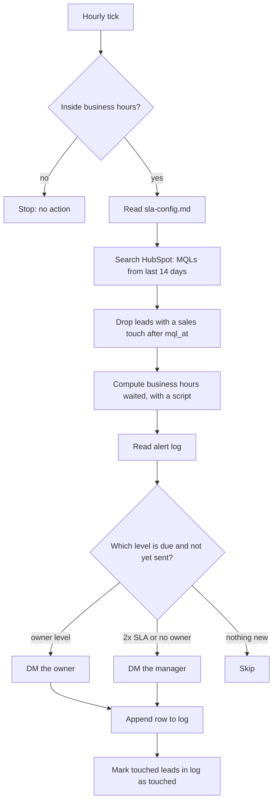

# MQL follow-up SLA watchdog

> Pings the sales rep when a hot lead waits too long for a first touch, escalates to the
> manager when it waits much longer, and posts a daily list of misses.

| | |
|---|---|
| Key | `mql-sla-watchdog` |
| Sector | Marketing (demand generation and marketing operations) |
| Card category | Marketing |
| Pattern | Scheduled chaser |
| Trigger | Every hour on work days, plus a daily summary |
| Apps | HubSpot (required), Slack (required), Google Sheets (required, for the log) |
| Score | 100 (Pain 4, Recurrence 5, Ease 5) |

## 1. The world this lives in

In a software company, marketing creates interest and sales closes deals. A **lead** is a
person who showed interest: they filled in a demo form, downloaded a guide, or signed up for a
webinar. Marketing scores leads. When a lead looks ready to talk to sales, marketing marks it
as an **MQL** (marketing qualified lead) and hands it to a sales rep.

The handoff is where leads get lost. The rep is busy, the lead has no owner, or the lead
arrives on a Friday evening. Marketing paid to create the lead and cannot see that nobody
called it.

Words you will see:

| Word | Meaning |
|---|---|
| Lead | A person who showed interest in the product. |
| MQL | Marketing qualified lead: a lead marketing thinks is ready for sales. |
| SQL | Sales qualified lead: a lead a rep has talked to and accepted. |
| Lifecycle stage | A HubSpot contact field that holds the stage: subscriber, lead, MQL, SQL, opportunity, customer. |
| Lead owner | The sales rep assigned to the lead (`hubspot_owner_id` in HubSpot). |
| SLA | Service level agreement. Here: the promise that sales touches every MQL within a set time, for example 1 business hour. |
| First touch | The first sales activity on the lead: a call, an email, or a meeting logged in the CRM. |
| Speed to lead | The time from MQL to first touch. Shorter is better. |
| CRM | Customer relationship management system. HubSpot and Salesforce are CRMs. |

## 2. The problem today

How teams handle it now:

1. A marketing ops person opens a HubSpot report of new MQLs once or twice a day.
2. They check each lead's "last contacted" date by hand.
3. They message reps in Slack one by one, or forward a screenshot to the sales manager.
4. On busy days, nobody does this. Leads go cold.

Why it matters:

- An audit of 2,241 US companies found only 37% replied to a web lead within one hour, and
  23% never replied. Firms that made contact within one hour had about 7 times the odds of
  qualifying the lead [V, Harvard Business Review 2011, via secondary sources].
- Lead management is about one third of the 10,000 AI workflows Zapier analysed in 2026 [V].
  Teams want this automated.

## 3. What the agent does

Every hour during business hours, the agent:

1. Finds every MQL from the last 14 days that has had no sales touch.
2. Works out how long each one has waited, in business hours.
3. Sends the owner a Slack DM when a lead passes the SLA.
4. Sends the sales manager a DM when a lead passes two times the SLA, or has no owner.
5. Records each alert in a log sheet, so nobody gets the same alert twice.

Every morning, it posts one summary to a shared channel: misses from yesterday, leads still
waiting, and the median speed to lead.

The agent never changes HubSpot records and never contacts the lead.

## 4. Who installs it and who benefits

- **Installs it:** the marketing ops or revenue ops person, or the founder at a small company.
- **Gets alerts:** sales reps (owner DMs) and the sales manager (escalations).
- **Reads the summary:** marketing and sales leaders.

## 5. Apps it uses

| Connection key | Required | Composio options | What the agent does with it | Candidate actions | Policy |
|---|---|---|---|---|---|
| `crm` | yes | `hubspot` | Search contacts by lifecycle stage and dates; read owner, last activity, and company. Read the owner list to map owner ids to emails. | `HUBSPOT_SEARCH_CONTACTS`, `HUBSPOT_GET_CONTACT`, `HUBSPOT_LIST_OWNERS` | `allow_reads`; deny every write |
| `chat` | yes | `slack` | Look up users by email; DM owners and the manager; post the daily summary. | `SLACK_LOOKUP_USER_BY_EMAIL`, `SLACK_SEND_MESSAGE` | allow these two; deny the rest |
| `log` | yes | `googlesheets` | Read and append rows in the alert log. | `GOOGLESHEETS_GET_VALUES`, `GOOGLESHEETS_APPEND_VALUES` | allow |

Salesforce (`salesforce`) is a later option. Salesforce uses a Lead object with a status field
instead of a lifecycle stage, so it needs its own query step. Keep v1 HubSpot only.

## 6. Setup: what the user provides

Required (one `request_input` form):

| Field | Why | Default |
|---|---|---|
| SLA in business hours | The threshold for the first alert. | `1` |
| Business hours and timezone | Leads that arrive at night do not count until the day starts. | `09:00-18:00`, Monday-Friday, the user's timezone |
| Sales manager email | Gets escalations and no-owner leads. | none |
| Summary channel | Where the daily summary goes. | `#sales-marketing` |

Researchable (the builder agent looks these up and states its assumption):

- **The "first touch" field.** HubSpot has several. Use `hs_last_sales_activity_timestamp`
  first, then `notes_last_contacted`. If both are empty, the lead has no touch.
- **The MQL date field.** Use `hs_lifecyclestage_marketingqualifiedlead_date`.
- **Owner field.** `hubspot_owner_id`.

Seed files (in `workspace.entries`):

- `sla-config.md`: the values above, plus optional rules such as "leads from the Enterprise
  form have a 30-minute SLA" and "ignore leads with these email domains: gmail.com,
  competitor.com". The agent reads this file at the start of every run.

The log sheet: setup asks the user to create or pick a Google Sheet with a tab named
`mql-alerts` and these columns:

`contact_id | email | mql_at | owner_email | level | alerted_at | status`

`level` is `owner`, `manager`, or `no_owner`. `status` is `open` or `touched`.

## 7. Automations

| Key | Trigger | Schedule (UTC) | Message to the agent |
|---|---|---|---|
| `hourly-check` | schedule | `5 * * * 1-5` (minute 5 of every hour, Monday-Friday). The agent skips hours outside business hours in its procedure. | "Run the MQL SLA check now." |
| `daily-summary` | schedule | `0 8 * * 1-5` adjusted to 09:00 in the user's timezone | "Post the daily MQL SLA summary now." |

Notes:

- Cron is UTC. The builder agent converts the user's 09:00 to UTC when it creates the schedule.
- A HubSpot event trigger ("contact lifecycle stage changed") is not needed. An hourly check
  is simpler and cannot miss events. If a candidate HubSpot trigger exists, it can be added
  later to give instant alerts for the 30-minute Enterprise rule.

## 8. How one run works



Procedure for `AGENTS.md`, hourly check:

1. Read `sla-config.md`.
2. Get the current time in the configured timezone with a short script (`bash`: `date`). If
   it is outside business hours, stop with "Outside business hours, no check."
3. Call `HUBSPOT_SEARCH_CONTACTS` with filters: `lifecyclestage = marketingqualifiedlead` and
   `hs_lifecyclestage_marketingqualifiedlead_date` in the last 14 days. Request the
   properties `email`, `firstname`, `lastname`, `company`, `hubspot_owner_id`,
   `hs_lifecyclestage_marketingqualifiedlead_date`, `hs_last_sales_activity_timestamp`,
   `notes_last_contacted`, `hs_analytics_source`.
4. Drop each contact whose last sales activity is later than its MQL date. Drop contacts that
   match an ignore rule.
5. For the rest, compute business hours waited with a script, not by mental arithmetic. Count
   only time inside the configured business hours and days.
6. Read the `mql-alerts` tab. For each contact, find the highest level already sent.
7. Decide the level due (see section 9). Send only levels not yet sent.
8. For each alert, map the owner id to an email (`HUBSPOT_LIST_OWNERS`), then the email to a
   Slack user (`SLACK_LOOKUP_USER_BY_EMAIL`), then DM with the message format in section 10.
9. Append one row to the log per alert sent.
10. For each open log row whose contact now has a touch, update the status to `touched`.
11. End with a one-line run report: "Checked 23 MQLs, 2 owner alerts, 1 manager alert."

Procedure, daily summary:

1. Read the log and HubSpot MQLs from the previous business day.
2. Compute: MQLs created, touched within SLA, missed SLA, still waiting, median speed to lead.
3. Post the summary to the summary channel.

## 9. Decision rules

| Situation | Action |
|---|---|
| Lead touched after MQL | No alert. Mark log row `touched` if one exists. |
| No owner, any wait | DM manager once (`no_owner`). |
| Waited ≥ SLA, < 2x SLA, owner level not sent | DM owner (`owner`). |
| Waited ≥ 2x SLA, manager level not sent | DM manager, mention the owner (`manager`). |
| Owner email has no Slack user | DM the manager instead, and say why. |
| More than 20 alerts for one person in one run | Send one grouped message, not 20 DMs. |
| Lead older than 14 days | Ignore. It is out of the watch window. |

## 10. Outputs

Owner DM:

```
⏱️ New MQL waiting 1h 20m (SLA: 1h)
Dana Ruiz, Head of Data at Acme Corp (dana@acme.com)
Source: Demo request form · MQL at 10:05
Open in HubSpot: <contact link>
Reply here once you've reached out, or log the call in HubSpot.
```

Manager DM:

```
🚨 MQL past 2x SLA: Dana Ruiz (Acme Corp) has waited 2h 15m.
Owner: Sam Lee. Owner was pinged at 11:25.
Open in HubSpot: <contact link>
```

Daily summary (channel):

```
MQL follow-up, Tue 14 Oct
• 18 new MQLs · 14 touched within SLA (78%) · 3 missed · 1 still waiting
• Median speed to lead: 42 min
• Still waiting: Dana Ruiz (Acme, 5h, owner Sam Lee)
• No owner: 0
```

## 11. Worked example

At 11:05 the hourly check finds 23 MQLs from the last 14 days. 19 have a sales activity after
their MQL date. Of the other 4: one arrived at 10:50 (15 minutes, under SLA); one has waited
1h 20m (owner alert due); one has waited 2h 30m and its owner was alerted at 10:05 (manager
alert due); one has no owner (manager alert due). The agent sends three DMs, appends three log
rows, and reports "Checked 23 MQLs, 1 owner alert, 2 manager alerts."

## 12. Guardrails

- Read-only on HubSpot. The agent never changes owners, stages, or properties.
- The agent never emails or calls the lead.
- Message only people who exist in Slack and in the HubSpot owner list.
- Do not post lead details in a public channel other than the configured summary channel.

## 13. Edge cases and failures

| Case | Handling |
|---|---|
| HubSpot search returns more than 100 results | Page through results. Stop at 500 and say so in the report. |
| The lead was touched in a tool that does not sync to HubSpot (for example a dialer) | The agent cannot see it. SETUP.md tells the user to sync activities, or to add an ignore rule. |
| Holiday | Optional `holidays:` list in `sla-config.md`; those days count as non-business days. |
| Slack lookup fails | Fall back to the manager, and include the owner name. |
| Sheet missing or renamed | Stop and report "Log sheet not found". Do not send alerts without a log, or it will spam. |

## 14. State and de-duplication

The log sheet is the only state. The pair (`contact_id`, `level`) is unique: the agent sends
each level at most once per lead. Because the log lives in a sheet, a new run never depends on
agent memory.

## 15. Compute and cost

One HubSpot search (plus paging), one owner list call, one sheet read, a few Slack calls, and
one short LLM pass to decide and write messages. A small script does the time math. Typical
run: under 10 tool calls and well under 10k tokens. 24 runs a day on work days is cheap.

## 16. How to test it

1. `test_run` with "Run the MQL SLA check now." against a HubSpot test portal that has one
   MQL with no activity and an MQL date two hours ago. Expect one manager-level DM and one log
   row. Read the log sheet back to confirm.
2. Run it again at once. Expect no new DMs (de-duplication works).
3. Log a call on the contact in HubSpot. Run again. Expect the log row to change to `touched`.
4. Turn on `hourly-check` and use Play "Run" on the schedule to fire it once for real.

## 17. Success metrics

- Share of MQLs touched within SLA (goal: up week over week).
- Median speed to lead.
- Number of manager escalations (goal: down over time).

## 18. Package sketch

```json
{
  "schema_version": 1,
  "entry": "mql-sla-watchdog",
  "agents": {
    "mql-sla-watchdog": {
      "name": "MQL follow-up SLA watchdog",
      "description": "Alerts sales when a marketing qualified lead waits too long for a first touch.",
      "instructions": "./ai.agenta/agents/mql-sla-watchdog/AGENTS.md",
      "setup": "./ai.agenta/agents/mql-sla-watchdog/SETUP.md",
      "connections": [
        { "key": "crm", "required": true, "purpose": "Read MQLs, owners and last sales activity.",
          "options": [{ "kind": "gateway", "provider": "composio", "integration": "hubspot" }],
          "policy": { "permissions": { "default": "allow_reads", "tools": {} } } },
        { "key": "chat", "required": true, "purpose": "DM owners and the manager; post the daily summary.",
          "options": [{ "kind": "gateway", "provider": "composio", "integration": "slack" }],
          "policy": { "permissions": { "default": "deny", "tools": {
            "SLACK_SEND_MESSAGE": "allow", "SLACK_LOOKUP_USER_BY_EMAIL": "allow" } } } },
        { "key": "log", "required": true, "purpose": "Keep the alert log so no alert repeats.",
          "options": [{ "kind": "gateway", "provider": "composio", "integration": "googlesheets" }],
          "policy": { "permissions": { "default": "allow", "tools": {} } } }
      ],
      "automations": [
        { "key": "hourly-check", "name": "Hourly SLA check", "required": true,
          "trigger": { "type": "schedule", "schedule": "5 * * * 1-5" },
          "inputs_fields": { "messages": [{ "role": "user", "content": "Run the MQL SLA check now." }] },
          "setup_notes": "Runs every hour on weekdays; the agent skips hours outside business hours." },
        { "key": "daily-summary", "name": "Daily summary", "required": false,
          "trigger": { "type": "schedule", "schedule": "0 8 * * 1-5" },
          "inputs_fields": { "messages": [{ "role": "user", "content": "Post the daily MQL SLA summary now." }] },
          "setup_notes": "Confirm the time in your timezone; cron is UTC." }
      ],
      "workspace": { "entries": [
        { "type": "file", "source": "./ai.agenta/agents/mql-sla-watchdog/files/sla-config.md", "path": "sla-config.md" }
      ] }
    }
  }
}
```

## 19. Catalog card

- Summary: "Pings sales when a hot lead waits too long."
- Trigger label: "Every hour" · description: "Checks new MQLs every business hour."
- Seed message: "Build an agent that alerts our sales reps in Slack when an MQL in HubSpot
  has no follow-up within one business hour."
- Example: prompt "Hourly check, 11:05" → steps "Found 4 untouched MQLs", "1 past SLA, 2 past
  2x SLA", "Sent 3 Slack DMs and logged them" → status "Done".

## 20. Open questions

- Does the Composio HubSpot search action accept date filters on
  `hs_lifecyclestage_marketingqualifiedlead_date`? Verify before writing AGENTS.md.
- Should the agent accept a Slack reply ("done") as a touch? v1: no; the CRM is the truth.
