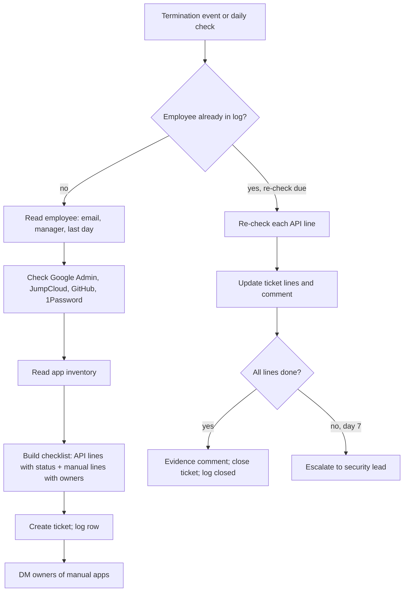

# Offboarding checklist runner

> When someone leaves the company, checks every app for access they still have, and opens one
> tracked checklist for IT with each app's status, the shared passwords to change, and the
> files to hand over. Re-checks on day 1 and day 7 until everything is closed.

| | |
|---|---|
| Key | `offboarding-checklist-runner` |
| Sector | Security & Compliance (IT operations and people operations) |
| Card category | Security |
| Pattern | Scheduled chaser (one event starts a checklist; scheduled re-checks close it) |
| Trigger | An HR "employee terminated" event, a daily HR check as fallback, or a manual run |
| Apps | BambooHR or Rippling (required), Google Admin (required), Jira or Freshservice (required), Slack (required), GitHub, 1Password, JumpCloud (optional) |
| Score | 80 (Pain 5, Recurrence 4, Ease 4) |

## 1. The world this lives in

When an employee leaves, IT must remove their access to every company system. This is
**offboarding**. If it is incomplete, a former employee can still read customer data, push
code, or log in to a billing tool. Auditors check offboarding in every SOC 2 audit: they pick
a sample of people who left and ask for proof that access was removed on time.

Most companies use **SSO** (single sign-on) through Google Workspace, Okta, or JumpCloud. When
IT suspends the person in the SSO tool, all SSO apps lock. But many apps are not behind SSO:
they have their own passwords, personal accounts that were invited by email, API keys, shared
logins in a password manager, or OAuth grants ("Sign in with Google" to a third-party tool).
Those are the gaps.

Words you will see:

| Word | Meaning |
|---|---|
| Offboarding | Removing a leaving employee's access and recovering company assets. |
| HRIS | HR information system: BambooHR, Rippling, Gusto, Workday. It holds the termination date. |
| IdP / SSO | Identity provider / single sign-on: the system that logs people into other apps (Google Workspace, Okta, JumpCloud). |
| Suspend / deprovision | Turn off an account; remove it from apps. |
| SCIM | A standard that lets the IdP remove accounts in apps automatically. |
| OAuth grant | Permission a user gave a third-party app to use their Google or GitHub account. |
| Shared credential | A password several people know, often in a vault in 1Password. Rotate it when one of them leaves. |
| Rotate | Change a password or key so the old one no longer works. |
| Data transfer | Moving the person's Drive files, calendars, and email to their manager. |
| App inventory | The list of all apps the company uses, with an owner per app. |
| Evidence | Proof for auditors: a ticket with timestamps showing each step was done. |

## 2. The problem today

How teams handle it now:

1. HR tells IT in Slack or email that someone leaves on Friday.
2. IT suspends the Google account and removes the laptop.
3. IT tries to remember the other apps. Some are missed.
4. Weeks later, an auditor or a bill shows the person still has an account.

Why it matters:

- About half of IT professionals said they still had access at a former employer [Vv, Nudge
  Security, n=375]. An older survey found 48% of respondents knew former employees who still
  had access [V, OneLogin, around 2017].
- Each employee has dozens of OAuth grants to third-party apps [Vv, Nudge: 70-88].
- Offboarding is a standard SOC 2 control. A missed offboarding is an audit exception.

## 3. What the agent does

When HR marks an employee as terminated:

1. Reads the person's details: name, work email, manager, department, last day.
2. Checks each connected system for an active account: Google Workspace (user status, admin
   roles, groups, mail forwarding if available), GitHub (organization membership), JumpCloud
   (user status), 1Password (vaults the person could access).
3. Reads the **app inventory** sheet for every other app, with its owner.
4. Opens one ticket for IT with a checklist: each app with a status (still active / removed /
   cannot check), shared credentials to rotate, files and calendars to transfer, and laptop
   return.
5. Messages each app owner in Slack for apps the agent cannot check by API.
6. On the day after the last day, and on day 7, checks again and updates the ticket. It
   closes the ticket only when every line is done, and posts a final evidence comment.

The agent never suspends, deletes, or changes any account. People do every removal.

## 4. Who installs it and who benefits

- **Installs it:** the IT admin, the security lead, or the head of people ops.
- **Uses it:** IT (does the removals), app owners (confirm their app), HR (sees status).
- **Benefits:** the security lead and auditors (complete evidence).

## 5. Apps it uses

| Connection key | Required | Composio options | What the agent does with it | Candidate actions | Policy |
|---|---|---|---|---|---|
| `hris` | yes | `bamboohr`, `rippling` (Gusto later) | Receive or find terminations; read name, email, manager, last day. | `BAMBOOHR_GET_EMPLOYEE`, `BAMBOOHR_GET_CHANGED_EMPLOYEES` (candidate) | `allow_reads` |
| `directory` | yes | `google_admin` | Read the user: suspended or active, admin roles, groups, last login. | `GOOGLE_ADMIN_GET_USER`, `GOOGLE_ADMIN_LIST_GROUPS` (candidates) | `allow_reads`; **deny** every write (create, update, suspend, delete) |
| `idp` | no | `jumpcloud` | Read the user's state and the apps bound to them. | JumpCloud get user / list user associations | `allow_reads`; deny writes |
| `code` | no | `github` | Check organization membership and outside-collaborator access. | `GITHUB_CHECK_ORGANIZATION_MEMBERSHIP_FOR_A_USER`, `GITHUB_LIST_OUTSIDE_COLLABORATORS` | `allow_reads`; deny writes |
| `vault` | no | `_1password` | List the vaults and shared items the person could access, so IT knows what to rotate. | 1Password list vaults / list items (6 tools in toolkit) | `allow_reads`; **deny** update and delete |
| `tickets` | yes | `jira`, `freshservice` | Create the offboarding ticket; update its checklist; comment; close. | `JIRA_CREATE_ISSUE`, `JIRA_EDIT_ISSUE`, `JIRA_ADD_COMMENT`, `JIRA_TRANSITION_ISSUE`; Freshservice create/update ticket | allow these on the offboarding project only |
| `chat` | yes | `slack` | DM app owners; post status in the IT channel. | `SLACK_SEND_MESSAGE`, `SLACK_LOOKUP_USER_BY_EMAIL` | allow these; deny the rest |
| `inventory` | yes | `googlesheets` | Read the app inventory; write the run log. | `GOOGLESHEETS_GET_VALUES`, `GOOGLESHEETS_APPEND_VALUES` | allow |

Okta is the most common IdP but was not found in Composio. Until it is verified, Okta users
get Google Admin checks only, plus an "Okta: check manually" line in the checklist.

## 6. Setup: what the user provides

Required (one form):

| Field | Why | Default |
|---|---|---|
| Ticket project | Where offboarding tickets go. | none |
| IT channel | Status posts. | `#it-ops` |
| IT owner | Assignee for the ticket. | the installer |

Seed files and sheets:

- **App inventory sheet** (tab `apps`), the builder agent creates it and the user fills it:

`app | how_to_check (api:google_admin / api:github / api:jumpcloud / manual) | sso (yes/no) | owner_email | notes`

Example rows: `GitHub | api:github | no | alex@ | org: example-inc`; `Figma | manual | yes |
maria@ | SSO via Google, check guest seats`; `AWS | manual | no | alex@ | IAM users and keys`.

- `offboarding-rules.md`:

```markdown
## Always in the checklist
- Suspend Google Workspace account (after last day)
- Transfer Drive files and calendar to manager
- Set email forwarding or auto-reply (per HR policy)
- Remove from all groups and shared drives
- Rotate shared credentials in the vaults listed below
- Recover laptop and badge
- Remove from payroll tools (HR)

## Timing
Day 0 = last day. Checks run: day 0 (on event), day 1, day 7.
SLA: all access removed by end of day 1.
```

Run log tab `offboarding-log`, columns:

`employee_id | email | last_day | ticket_id | opened_at | day1_check | day7_check | status`

## 7. Automations

| Key | Trigger | Detail | Message to the agent |
|---|---|---|---|
| `termination` | subscription: BambooHR employee status changed (candidate trigger; verify) | Starts a checklist. | "Start offboarding for the employee in inputs.event." + `"event": "$.event.attributes"` |
| `daily-check` | schedule `0 7 * * *` | Fallback and re-checks: finds new terminations in the HRIS (last 3 days) not in the log; runs day 1 and day 7 checks for open rows. | "Start offboarding for new terminations and run due re-checks." |

Manual: IT can type "Offboard jane@example.com, last day Friday" in chat when HR has not
updated the HRIS yet.

## 8. How one run works



Procedure for `AGENTS.md`, start:

1. Read `offboarding-rules.md` and the app inventory.
2. Read the employee from the HRIS: name, work email, manager (name and email), department,
   last day. If the termination date is in the future, set day 0 to that date.
3. If the log already has this employee, go to the re-check procedure.
4. For each `api:` app, check the account:
   - Google Admin: is the user active or suspended? Admin roles? Group count?
   - JumpCloud: user state and bound apps.
   - GitHub: is the work email (or the GitHub username stored in the HRIS custom field)
     an organization member or outside collaborator?
   - 1Password: list the vaults the user can access and the count of shared items.
5. Build the checklist. Each line: app, check method, status (`active`, `removed`,
   `not found`, `cannot check`), owner, and the action needed. Add the "always" lines from the
   rules.
6. Create the ticket (section 10), assign the IT owner, and set the due date to day 1.
7. Append the log row.
8. DM each `manual` app owner once: "Jane Doe leaves on Fri 17 Oct. Please remove her from
   Figma and reply 'done' on <ticket link>."
9. Post one line in the IT channel with the ticket link.

Procedure, re-check (day 1 and day 7):

1. Re-run each `api:` check. Update the ticket lines that changed (for example Google: active
   → suspended).
2. Read ticket comments for owners' "done" confirmations on manual lines; mark those lines
   done.
3. If every line is done, add an evidence comment (each line, its final status, who confirmed
   it, and when), close the ticket, and set the log status `closed`.
4. On day 7 with open lines, DM the security lead with the open lines and keep the ticket open.

## 9. Decision rules

| Situation | Action |
|---|---|
| Last day in the future | Create the ticket now with due date = day 1 after the last day; checks show "still active (expected)". |
| Account active after day 0 | Status `active`, flagged ⚠️ on day 1 and escalated on day 7. |
| Person has Google admin roles | Put "Remove admin roles first" at the top. |
| Vault access to shared items | One line per vault: "Rotate shared items in vault 'Prod infra' (12 items)". Never list item names or secrets. |
| GitHub match not possible (no username) | Status `cannot check`, assign to the GitHub owner as manual. |
| Contractor leaves (HRIS type = contractor) | Same flow. |
| Rehire or cancelled termination | If the HRIS status returns to active, comment and close the ticket as cancelled. |

## 10. Outputs

Ticket:

```
Title: Offboarding: Jane Doe (Engineering) · last day Fri 17 Oct
Assignee: @it-owner · Due: Mon 20 Oct · Manager: Sam Lee

Accounts (checked by API, 17 Oct 09:00)
[ ] Google Workspace: ACTIVE · admin roles: none · 14 groups
[ ] GitHub (example-inc): MEMBER · 2 teams
[x] JumpCloud: not found
[ ] 1Password: access to 3 shared vaults → rotate items in "Prod infra" (12), "Marketing tools" (5), "Support" (3)

Apps to check by owner
[ ] Figma · owner @maria
[ ] AWS IAM users and keys · owner @alex
[ ] Stripe dashboard · owner @finance-lead

Always
[ ] Transfer Drive files and calendar to Sam Lee
[ ] Email auto-reply per HR policy
[ ] Recover laptop and badge
```

Final evidence comment:

```
All 11 lines closed on Mon 20 Oct 16:40.
Google Workspace suspended (verified by API 20 Oct 07:00) · GitHub removed (API 20 Oct 07:00) ·
Figma removed (confirmed by @maria 18 Oct 10:12) · ...
```

## 11. Worked example

BambooHR marks Jane Doe terminated with last day Friday. The agent finds her Google account
active (expected before the last day), GitHub member, three shared vaults, and three manual
apps in the inventory. It opens the ticket and DMs Maria, Alex, and the finance lead. On
Monday morning (day 1) Google shows suspended and GitHub removed; Maria and Alex have replied
"done". The finance lead has not. On day 7 the agent DMs the security lead about the open
Stripe line. The finance lead confirms; the next check closes the ticket with the evidence
comment.

## 12. Guardrails

- Read-only on every identity and access system. The policy denies all writes to Google Admin,
  JumpCloud, GitHub, and 1Password.
- The agent never prints secrets, passwords, or vault item names; only vault names and counts.
- The agent never messages the leaving employee.
- Ticket writes are limited to the offboarding project.

## 13. Edge cases and failures

| Case | Handling |
|---|---|
| A check API fails | Line status `cannot check (error)`; the next re-check tries again. |
| Personal email used for some apps | Owners check by name; the agent adds "Search by name too" to manual lines. |
| Many terminations at once (layoff) | One ticket per person; one combined IT channel message; owner DMs grouped per owner. |
| The inventory sheet is empty | Create the ticket with API lines and "always" lines, plus a warning to fill the inventory. |
| Employee had no work email | Stop and ask IT in the channel. |

## 14. State and de-duplication

The `offboarding-log` sheet holds one row per employee. The ticket holds the checklist state.
A second termination event for the same employee finds the log row and does a re-check
instead of opening a second ticket.

## 15. Compute and cost

About 5-10 reads per person and a few writes. One LLM pass to build the checklist text.
Re-checks are smaller. Offboardings happen a few times a month at most companies.

## 16. How to test it

1. In a test Google Workspace, create a test user in two groups; add them to a test GitHub
   org.
2. Fill the inventory with two `api:` apps and one `manual` app.
3. `test_run` with "Start offboarding for the employee in inputs.event." and a sample HRIS
   payload for that user. Expect a ticket with Google ACTIVE, GitHub MEMBER, one owner DM.
4. Suspend the user and remove them from GitHub by hand; reply "done" on the ticket as the
   owner. Run the re-check. Expect the ticket closed with an evidence comment.
5. Turn on `daily-check`; use Play "Run".

## 17. Success metrics

- Share of offboardings with all access removed by end of day 1.
- Open offboarding lines older than 7 days (goal: zero).
- Audit exceptions on offboarding (goal: zero).

## 18. Package sketch

```json
{
  "schema_version": 1,
  "entry": "offboarding-checklist-runner",
  "agents": {
    "offboarding-checklist-runner": {
      "name": "Offboarding checklist runner",
      "description": "Checks every app for leftover access when someone leaves and tracks one checklist until it is closed.",
      "instructions": "./ai.agenta/agents/offboarding-checklist-runner/AGENTS.md",
      "setup": "./ai.agenta/agents/offboarding-checklist-runner/SETUP.md",
      "connections": [
        { "key": "hris", "required": true, "purpose": "Find terminations and read employee details.",
          "options": [
            { "kind": "gateway", "provider": "composio", "integration": "bamboohr" },
            { "kind": "gateway", "provider": "composio", "integration": "rippling" } ],
          "policy": { "permissions": { "default": "allow_reads", "tools": {} } } },
        { "key": "directory", "required": true, "purpose": "Check the Google Workspace account. Read only.",
          "options": [{ "kind": "gateway", "provider": "composio", "integration": "google_admin" }],
          "policy": { "permissions": { "default": "allow_reads", "tools": {} } },
          "setup_notes": "Needs your own OAuth app with admin read scopes. The agent never suspends or deletes users." },
        { "key": "idp", "required": false, "purpose": "Check the JumpCloud user. Read only.",
          "options": [{ "kind": "gateway", "provider": "composio", "integration": "jumpcloud" }],
          "policy": { "permissions": { "default": "allow_reads", "tools": {} } } },
        { "key": "code", "required": false, "purpose": "Check GitHub organization access. Read only.",
          "options": [{ "kind": "gateway", "provider": "composio", "integration": "github" }],
          "policy": { "permissions": { "default": "allow_reads", "tools": {} } } },
        { "key": "vault", "required": false, "purpose": "List shared vaults to rotate. Read only.",
          "options": [{ "kind": "gateway", "provider": "composio", "integration": "_1password" }],
          "policy": { "permissions": { "default": "allow_reads", "tools": {} } } },
        { "key": "tickets", "required": true, "purpose": "Create and update the offboarding ticket.",
          "options": [
            { "kind": "gateway", "provider": "composio", "integration": "jira" },
            { "kind": "gateway", "provider": "composio", "integration": "freshservice" } ],
          "policy": { "permissions": { "default": "allow_reads", "tools": {
            "JIRA_CREATE_ISSUE": "allow", "JIRA_EDIT_ISSUE": "allow", "JIRA_ADD_COMMENT": "allow", "JIRA_TRANSITION_ISSUE": "allow" } } } },
        { "key": "chat", "required": true, "purpose": "DM app owners and post status.",
          "options": [{ "kind": "gateway", "provider": "composio", "integration": "slack" }],
          "policy": { "permissions": { "default": "deny", "tools": {
            "SLACK_SEND_MESSAGE": "allow", "SLACK_LOOKUP_USER_BY_EMAIL": "allow" } } } },
        { "key": "inventory", "required": true, "purpose": "Read the app inventory and keep the log.",
          "options": [{ "kind": "gateway", "provider": "composio", "integration": "googlesheets" }],
          "policy": { "permissions": { "default": "allow", "tools": {} } } }
      ],
      "automations": [
        { "key": "termination", "name": "Employee terminated", "required": false,
          "trigger": { "type": "subscription", "connection": "hris", "event_key": "<verify BambooHR trigger>", "trigger_config": {} },
          "inputs_fields": { "messages": [{ "role": "user", "content": "Start offboarding for the employee in inputs.event." }],
                             "event": "$.event.attributes" } },
        { "key": "daily-check", "name": "Daily check and re-checks", "required": true,
          "trigger": { "type": "schedule", "schedule": "0 7 * * *" },
          "inputs_fields": { "messages": [{ "role": "user", "content": "Start offboarding for new terminations and run due re-checks." }] } }
      ],
      "workspace": { "entries": [
        { "type": "file", "source": "./ai.agenta/agents/offboarding-checklist-runner/files/offboarding-rules.md", "path": "offboarding-rules.md" }
      ] }
    }
  }
}
```

## 19. Catalog card

- Summary: "Catches leftover access when someone leaves."
- Trigger label: "Employee leaves" · description: "Runs when HR marks an employee as terminated."
- Seed message: "Build an agent that, when BambooHR marks someone as leaving, checks Google
  Workspace, GitHub and 1Password for their access, opens one Jira checklist for IT, and
  re-checks until everything is removed."
- Example: prompt "Jane Doe leaves Friday" → steps "Google active, GitHub member, 3 vaults",
  "Opened a checklist with 11 lines", "Asked 3 app owners to confirm" → status "Tracking".

## 20. Open questions

- Confirm the BambooHR (or Rippling) trigger for termination; else the daily check is the only
  trigger (up to 24 hours delay, acceptable when HR enters terminations in advance).
- Confirm which Google Admin read actions exist in the 14-tool toolkit (user get, groups, roles).
  Mail forwarding settings may not be readable; then it becomes a manual line.
- Okta support: check for a Composio toolkit or an Okta MCP server.
