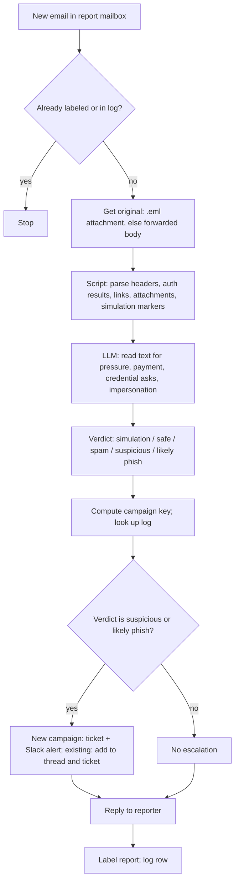

# Reported phish triager

> Reads every email that staff report as suspicious, classifies it (simulation, safe, spam,
> suspicious, likely phishing) from its headers and text, thanks the reporter with the
> verdict, and escalates real threats to the security team with a ticket.

| | |
|---|---|
| Key | `phishing-report-triager` |
| Sector | Security & Compliance (security operations) |
| Card category | Security |
| Pattern | Inbound extractor |
| Trigger | A new email in the phishing report mailbox; a schedule every 15 minutes as fallback |
| Apps | Gmail or Outlook (required), Slack (required), Jira (optional), Google Sheets (required, for the log) |
| Score | 75 (Pain 3, Recurrence 5, Ease 5) |

## 1. The world this lives in

**Phishing** is a fake email that tries to make someone click a bad link, open a bad file, or
send money or passwords. It is the most common way attackers get in. The human element is
part of about 60% of breaches [V, Verizon DBIR 2025].

Companies train staff to report suspicious emails. Staff forward them to a mailbox such as
`phishing@company.com`, or click a "Report phishing" button. Most reports are harmless: real
newsletters, internal emails, or the company's own **phishing simulation** (a fake phishing
test sent by the security team to train people). But each report needs a check and a reply,
or people stop reporting.

Words you will see:

| Word | Meaning |
|---|---|
| Phishing | A fake email that tries to steal credentials, money, or access. |
| Spear phishing | A phishing email aimed at one person, often using their name and role. |
| BEC | Business email compromise: a fake "CEO" or "supplier" asks for a payment or gift cards. |
| Simulation | A fake phishing email the company sends to test staff (KnowBe4, Proofpoint, etc.). |
| Headers | Hidden technical lines in an email: who really sent it, the path, and the checks. |
| SPF, DKIM, DMARC | Three checks that show whether the sending server is allowed to send for that domain. Results appear in the `Authentication-Results` header. |
| Display-name spoofing | "From: CEO Name <random@gmail.com>": the name looks right, the address does not. |
| Lookalike domain | A domain that looks like yours: `examp1e.com`, `example-billing.com`. |
| Reply-To mismatch | The reply goes to a different address than the sender. A common BEC sign. |
| IOC | Indicator of compromise: a sender, domain, or URL linked to an attack. |
| Purge | Remove the email from every inbox that got it (done in Google Workspace or Microsoft 365 admin tools). |
| `.eml` | A saved email file with all headers. "Forward as attachment" creates one. |

## 2. The problem today

How teams handle it now:

1. Reports pile up in the phishing mailbox.
2. A security engineer opens each one, reads the headers, and decides.
3. Replies to reporters are late or never sent.
4. A real campaign (the same email sent to 40 people) is noticed late because each report is
   handled alone.

Why it matters:

- 60-70% of user-reported emails are false positives [Vv, Agari]. Around a third are malicious
  or highly suspicious [Vv, F-Secure]. The real ones hide among the harmless ones.
- A fast, friendly reply keeps people reporting, which is the company's early warning.

## 3. What the agent does

For each new report in the phishing mailbox:

1. Gets the original email: from the `.eml` attachment if present, else from the forwarded
   text.
2. Extracts the signals with a script: sender, display name, reply-to, return path, SPF/DKIM/
   DMARC results, link text versus link target, attachment names and types, and known
   simulation headers. It makes no network lookups (no domain-age or reputation checks).
3. Asks the LLM to read the text for pressure signs: urgency, payment or gift-card requests,
   password or MFA requests, a fake login page, an unusual request from an executive.
4. Classifies into one of five verdicts.
5. Replies to the reporter with a short, friendly verdict.
6. For **suspicious** and **likely phishing**: opens a ticket with the signals and the IOCs,
   alerts the security channel, and groups reports of the same campaign.
7. Logs every report.

The agent never clicks links, never opens or runs attachments, never fetches URLs, and never
purges or blocks anything. A security engineer does the response.

## 4. Who installs it and who benefits

- **Installs it:** the security lead or IT admin.
- **Benefits:** the security team (only real threats need their time) and every employee
  (fast feedback).

## 5. Apps it uses

| Connection key | Required | Composio options | What the agent does with it | Candidate actions | Policy |
|---|---|---|---|---|---|
| `mailbox` | yes | `gmail`, `outlook` | Receive new reports; read the message, headers, and attachments metadata; download `.eml` attachments; reply to the reporter; label the report. | `GMAIL_FETCH_MESSAGE_BY_MESSAGE_ID`, `GMAIL_GET_ATTACHMENT`, `GMAIL_REPLY_TO_THREAD`, `GMAIL_ADD_LABEL_TO_EMAIL` | allow read, reply, label; **deny** send-new, forward, delete |
| `chat` | yes | `slack` | Alert the security channel; update the campaign thread. | `SLACK_SEND_MESSAGE` | allow this one; deny the rest |
| `tickets` | no | `jira` | One ticket per campaign (not per report). | `JIRA_CREATE_ISSUE`, `JIRA_ADD_COMMENT` | allow these only |
| `log` | yes | `googlesheets` | One row per report; used to group campaigns. | `GOOGLESHEETS_GET_VALUES`, `GOOGLESHEETS_APPEND_VALUES` | allow |

The connected mailbox is the phishing report mailbox (a shared Google Group or a dedicated
user), not a person's inbox.

## 6. Setup: what the user provides

Required (one form):

| Field | Why | Default |
|---|---|---|
| Report mailbox | Where staff forward suspicious emails. | `phishing@<your domain>` |
| Company domains | To spot lookalikes and internal mail. | the mailbox domain |
| Security channel | Where alerts go. | `#security-alerts` |

Seed files:

- `phish-rules.md`:

```markdown
## Our domains
example.com, example.io

## Known safe senders (vendors we use)
notifications@github.com, no-reply@accounts.google.com, *@slack.com, *@stripe.com

## Simulation markers
headers: X-PHISHTEST, X-KnowBe4-*, X-PhishMe
sender domains used by our simulation tool: <domain>

## Executives (for impersonation checks)
Jane Smith (CEO), Raj Patel (CFO)

## Reporter replies
Tone: thankful, short, no blame. Always end with: "Keep reporting — it helps."
Sending replies: auto for "simulation", "safe", "spam"; auto for "suspicious" and "likely phish" with the warning text.
```

- `report-instructions.md`: one paragraph for staff on how to report ("Forward as attachment
  to phishing@"). SETUP.md asks the user to share it, because `.eml` attachments give the
  agent full headers.

Log sheet tab `phish-reports`, columns:

`report_id | received_at | reporter | orig_from | orig_subject | orig_message_id | verdict | signals | campaign_key | ticket_id | replied`

## 7. Automations

| Key | Trigger | Detail | Message to the agent |
|---|---|---|---|
| `new-report` | subscription: Gmail new message (candidate `GMAIL_NEW_GMAIL_MESSAGE`) on the report mailbox | One run per report. | "Triage the reported email in inputs.event." + `"event": "$.event.attributes"` |
| `sweep` | schedule `*/15 * * * *` | Fallback: unlabeled reports from the last 2 hours. | "Triage every unlabeled report in the phishing mailbox." |
| `weekly-summary` | schedule `0 8 * * 1` | Reports per verdict, top campaigns, simulation report rate. | "Post the weekly phishing report summary." |

## 8. How one run works



Procedure for `AGENTS.md`:

1. Read `phish-rules.md`.
2. Read the report message. If it has the label `triaged`, or its id is in the log, stop.
3. Get the original email:
   - If there is an `.eml` or `message/rfc822` attachment, download it and parse it with a
     script (Python `email` module). This gives full headers.
   - Else, parse the forwarded text block ("From:", "Sent:", "Subject:"). Note "headers not
     available" as a signal; confidence is lower.
4. With the script, extract:
   - From address and display name; Reply-To; Return-Path.
   - `Authentication-Results`: SPF, DKIM, DMARC pass or fail.
   - Whether the From domain is ours, a known safe sender, or a lookalike of ours (edit
     distance ≤ 2 or ours plus a word).
   - Display name equal to an executive name with a non-company address.
   - Every link: visible text and real target. Flag when the visible text shows one domain and
     the target is another; flag URL shorteners and raw IP addresses. Do not fetch any link.
   - Attachments: names and types only. Flag `.html`, `.htm`, `.iso`, `.zip` with executables,
     `.js`, `.vbs`, macro Office files (`.docm`, `.xlsm`). Do not open them.
   - Simulation markers from the rules.
5. Send the extracted signals plus the visible body text (first 3,000 characters) to one LLM
   pass. Ask for: pressure signs, payment or gift-card request, credential or MFA request,
   impersonation, and a verdict with reasons.
6. Apply the verdict rules (section 9). The script's hard rules win over the LLM.
7. Campaign key: normalized sender domain + normalized subject (lowercase, numbers removed).
   Look in the log for the same key in the last 72 hours.
8. For `suspicious` or `likely_phish`:
   - New key: create a Jira ticket and post a Slack alert (section 10). Save the Slack
     message timestamp in the log.
   - Existing key: add a comment to the ticket and reply in the Slack thread: "Another report
     (now 7). Reporters: ...".
9. Reply to the reporter in the same thread with the verdict text.
10. Add the label `triaged` and a verdict label (`phish/likely`, `phish/safe`, ...). Append the
    log row.

## 9. Decision rules

Verdicts, in order (first match wins):

| Verdict | Rule |
|---|---|
| `simulation` | A simulation header or simulation sender domain is present. |
| `likely_phish` | Any of: lookalike of our domain; executive display name with an outside address; DMARC fail for a domain that claims to be ours or a known vendor; a credential, MFA, or payment request plus a link-target mismatch; a dangerous attachment type. |
| `suspicious` | Any of: link-target mismatch or shortener; Reply-To on a different domain; SPF or DKIM fail; strong pressure language; headers not available and the LLM sees phishing signs. |
| `spam` | Bulk marketing with a working unsubscribe link and passing authentication, no credential or payment ask. |
| `safe` | From our domain or a known safe sender, authentication passes, no risky signals. |

Other rules:

- When in doubt between two verdicts, pick the more cautious one.
- Never tell a reporter "safe" when headers were not available; say "looks like normal email,
  but we couldn't check the technical details".
- A report from an executive, or a payment request, always goes to the security channel, even
  when it is `suspicious`.

## 10. Outputs

Reply to the reporter (likely phish):

```
Thanks for reporting this, Dana. It looks like a phishing email: it pretends to be from our
CEO, but it was sent from an outside address and asks for gift cards.
Please don't reply or click anything in it. If you already did, tell #security-help now.
Our security team is on it. Keep reporting — it helps.
```

Reply to the reporter (simulation):

```
Nice catch, Dana! This was one of our phishing training emails. Reporting it was exactly
right. Keep reporting — it helps.
```

Slack alert (security channel):

```
🎣 Likely phishing · campaign "urgent gift card request" · 1 report so far
From: "Jane Smith" <jane.smith.ceo@gmail.com> · Reply-To: same
Signals: executive display name with outside address · payment request · DMARC: none
Links: none · Attachments: none
First reporter: dana@example.com at 10:02 · Ticket: SEC-412
Next steps for a human: purge from all inboxes; block sender.
```

Jira ticket: title "Phishing campaign: urgent gift card request (gmail.com)", the signals
table, IOCs (sender addresses, domains, link targets as defanged text like
`hxxps://examp1e-login[.]com`), and the list of reporters, updated as reports arrive.

Weekly summary: reports by verdict, campaigns with report counts, average reply time, and the
share of simulation emails that people reported.

## 11. Worked example

At 10:02 Dana forwards an email as an attachment. The `.eml` shows "Jane Smith"
`<jane.smith.ceo@gmail.com>`, no DMARC alignment for example.com, and the text "I need you to
buy 5 gift cards for a client today, keep this quiet". The script flags executive
impersonation; the LLM flags a payment request and pressure. Verdict: `likely_phish`. The
agent opens SEC-412, alerts #security-alerts, and replies to Dana. By 10:20, six more people
report the same email; each gets a reply, and the Slack thread and ticket show "7 reports".
A security engineer purges the email from all inboxes.

## 12. Guardrails

- Never click, fetch, or resolve any URL. Never open, run, or convert attachments.
- Never purge, delete, block, or forward emails. The policy denies those actions.
- Write IOCs in defanged form (`hxxp`, `[.]`) so nobody clicks them by mistake.
- Replies go only to the reporter, in the report thread.
- Do not paste full email bodies into Slack; use the summary and signals.

## 13. Edge cases and failures

| Case | Handling |
|---|---|
| Forward without attachment (no headers) | Classify from visible text; cap the verdict confidence; tell the reporter to "forward as attachment" next time. |
| A report contains several forwarded emails | Triage the first; note the rest in the log for a human. |
| The reporter forwards a phishing email that has a login link they already used | The reply always says "If you already clicked or entered a password, tell #security-help now." Severity rises if the reporter's message says "I clicked". |
| Non-English email | The LLM reads the text in any language; replies in the reporter's language. |
| Mailbox flooded (an attack hits 500 people) | The campaign key groups them; Slack gets one alert and thread updates, not 500 alerts. |

## 14. State and de-duplication

The `triaged` label on the report and the log sheet prevent double processing. The campaign
key in the log groups repeated reports into one ticket and one Slack thread.

## 15. Compute and cost

One message read, at most one attachment download, a script, one LLM pass over a short text,
and three or four writes. About 2-4k tokens per report. No network lookups.

## 16. How to test it

1. Prepare three `.eml` files: a simulation email with an `X-PHISHTEST` header, a real GitHub
   notification, and a fake "CEO gift card" email from a Gmail address.
2. Forward each as an attachment to a test report mailbox.
3. `test_run` with "Triage the reported email in inputs.event." for each. Expect
   `simulation`, `safe`, and `likely_phish`; one ticket and one Slack alert for the third.
4. Forward the third email again from another account. Expect a thread update and a ticket
   comment, not a new ticket.
5. Turn on `new-report`; use Lightning "Test event".

## 17. Success metrics

- Median time from report to reply (goal: under 5 minutes).
- Share of reports that need a human (goal: only suspicious and likely phish).
- Simulation report rate (goal: up over time, because people trust the process).

## 18. Package sketch

```json
{
  "schema_version": 1,
  "entry": "phishing-report-triager",
  "agents": {
    "phishing-report-triager": {
      "name": "Reported phish triager",
      "description": "Classifies emails staff report as phishing, answers the reporter, and escalates real threats.",
      "instructions": "./ai.agenta/agents/phishing-report-triager/AGENTS.md",
      "setup": "./ai.agenta/agents/phishing-report-triager/SETUP.md",
      "connections": [
        { "key": "mailbox", "required": true, "purpose": "Read reports, reply to reporters and label them.",
          "options": [
            { "kind": "gateway", "provider": "composio", "integration": "gmail" },
            { "kind": "gateway", "provider": "composio", "integration": "outlook" } ],
          "policy": { "permissions": { "default": "allow_reads", "tools": {
            "GMAIL_REPLY_TO_THREAD": "allow", "GMAIL_ADD_LABEL_TO_EMAIL": "allow",
            "GMAIL_SEND_EMAIL": "deny", "GMAIL_DELETE_MESSAGE": "deny", "GMAIL_FORWARD_MESSAGE": "deny" } } },
          "setup_notes": "Connect the phishing report mailbox, not a personal inbox." },
        { "key": "chat", "required": true, "purpose": "Alert the security channel.",
          "options": [{ "kind": "gateway", "provider": "composio", "integration": "slack" }],
          "policy": { "permissions": { "default": "deny", "tools": { "SLACK_SEND_MESSAGE": "allow" } } } },
        { "key": "tickets", "required": false, "purpose": "One ticket per phishing campaign.",
          "options": [{ "kind": "gateway", "provider": "composio", "integration": "jira" }],
          "policy": { "permissions": { "default": "deny", "tools": {
            "JIRA_CREATE_ISSUE": "allow", "JIRA_ADD_COMMENT": "allow" } } } },
        { "key": "log", "required": true, "purpose": "Log reports and group campaigns.",
          "options": [{ "kind": "gateway", "provider": "composio", "integration": "googlesheets" }],
          "policy": { "permissions": { "default": "allow", "tools": {} } } }
      ],
      "automations": [
        { "key": "new-report", "name": "New report", "required": false,
          "trigger": { "type": "subscription", "connection": "mailbox", "event_key": "GMAIL_NEW_GMAIL_MESSAGE", "trigger_config": {} },
          "inputs_fields": { "messages": [{ "role": "user", "content": "Triage the reported email in inputs.event." }],
                             "event": "$.event.attributes" } },
        { "key": "sweep", "name": "15-minute sweep", "required": false,
          "trigger": { "type": "schedule", "schedule": "*/15 * * * *" },
          "inputs_fields": { "messages": [{ "role": "user", "content": "Triage every unlabeled report in the phishing mailbox." }] } },
        { "key": "weekly-summary", "name": "Weekly summary", "required": false,
          "trigger": { "type": "schedule", "schedule": "0 8 * * 1" },
          "inputs_fields": { "messages": [{ "role": "user", "content": "Post the weekly phishing report summary." }] } }
      ],
      "workspace": { "entries": [
        { "type": "file", "source": "./ai.agenta/agents/phishing-report-triager/files/phish-rules.md", "path": "phish-rules.md" },
        { "type": "file", "source": "./ai.agenta/agents/phishing-report-triager/files/report-instructions.md", "path": "report-instructions.md" }
      ] }
    }
  }
}
```

## 19. Catalog card

- Summary: "Answers every phishing report and escalates the real ones."
- Trigger label: "New report" · description: "Runs when someone forwards a suspicious email to your report mailbox."
- Seed message: "Build an agent that checks every email forwarded to phishing@, decides if it
  is a simulation, safe, spam or real phishing from its headers and text, replies to the
  reporter, and alerts #security-alerts with a Jira ticket for real threats."
- Example: prompt "Report from Dana: 'Urgent request from Jane'" → steps "Executive name
  from an outside Gmail address", "Payment request with pressure", "Replied to Dana, opened
  SEC-412" → status "Done".

## 20. Open questions

- Confirm the Composio Gmail new-message trigger slug and that it can watch a shared mailbox.
- Confirm the Gmail toolkit can download attachments as raw bytes for `.eml` parsing.
- Outlook: confirm reply and attachment actions before listing it as an option.
- Should replies for `likely_phish` wait for a human? v1 sends them at once, because the
  warning ("don't click") is time-critical.
