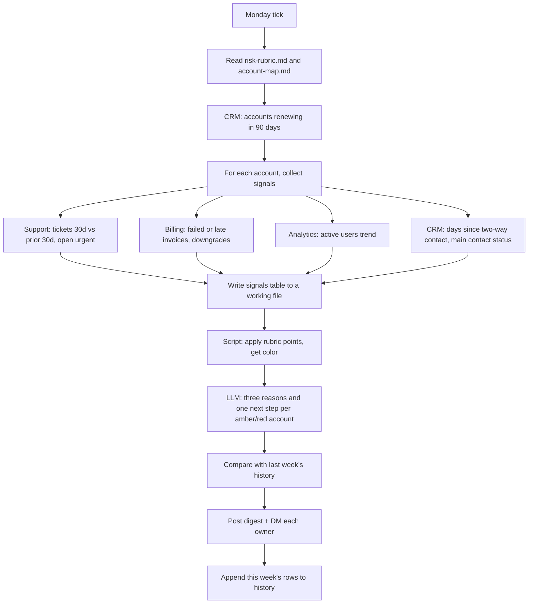

# Renewal risk digest

> Every Monday, lists the customers whose contracts renew in the next 90 days. Gives each one
> a risk color (red, amber, green), the evidence behind it, and one next step.

| | |
|---|---|
| Key | `renewal-risk-digest` |
| Sector | Customer Success (account management and renewals) |
| Card category | Customer Success |
| Pattern | Scheduled chaser (scheduled read across tools, one digest) |
| Trigger | Weekly, Monday morning |
| Apps | HubSpot or Salesforce (required), Slack (required), Zendesk or Intercom (optional), Stripe (optional), PostHog or Mixpanel (optional), Google Sheets (optional, history) |
| Score | 80 (Pain 5, Recurrence 4, Ease 4) |

## 1. The world this lives in

B2B software is usually sold on a contract for one year (sometimes more). At the end, the
customer **renews** or leaves. Renewals are most of a software company's revenue: in a recent
survey, 74% of CS and revenue leaders said most of their revenue comes from existing customers
[Vv, ChurnZero].

The customer success team watches accounts and tries to fix problems before the renewal date.
The problem is that the signals are spread across tools: support tickets in Zendesk, usage in
the product analytics tool, payments in Stripe, contacts and notes in the CRM. Nobody has time
to check every tool for every account every week.

Words you will see:

| Word | Meaning |
|---|---|
| Renewal date | The date the contract ends and must be renewed. |
| GRR | Gross revenue retention: the share of last year's revenue kept, ignoring upsells. |
| NRR / NDR | Net revenue (dollar) retention: GRR plus upsells. Above 100% means the base grows. |
| Health score | A score that sums up how healthy an account looks. |
| RAG | Red, amber, green: a simple risk color. |
| Champion | The person at the customer who likes the product and pushes for it internally. |
| Executive sponsor | The senior person who signs the renewal. |
| Usage / adoption | How much the customer uses the product, for example weekly active users. |
| Ticket spike | Many more support tickets than usual. |
| Book of business | The accounts one CSM owns. |
| Next step | The one action that would most reduce risk, for example "book a call with the new VP". |

## 2. The problem today

How teams handle it now:

1. The CS lead keeps a spreadsheet of renewals and updates it by hand.
2. Each CSM checks their accounts when they remember.
3. The weekly CS meeting spends most of its time collecting status, not fixing problems.
4. Risk shows up late: the champion left months ago, usage dropped, tickets piled up.

Why it matters:

- Private SaaS gross retention sits near 90% and fell in recent years [V, KeyBanc/Sapphire
  2025]. Each lost renewal is a whole year of revenue.
- CSMs in mid- and low-touch segments carry 49 to 144 accounts each [Vv, Gainsight]. Manual
  checking does not scale.

## 3. What the agent does

Every Monday morning:

1. Pulls every account with a renewal date in the next 90 days from the CRM.
2. For each account, collects a small set of signals: support tickets (last 30 days versus the
   30 before), open urgent tickets, failed or late payments, product usage change, days since
   the last two-way contact, and whether the main contact still seems active.
3. Applies a fixed scoring rubric to get red, amber, or green.
4. Writes three short reasons, each with a number, and one next step.
5. Posts one digest to the CS channel, grouped by 30 / 60 / 90 days, red first.
6. Sends each CSM a short DM with only their accounts.
7. Saves the week's results in a history sheet, so the next digest can say "new red" or
   "was red, now amber".

The agent never changes CRM records, never contacts customers, and never edits deals.

## 4. Who installs it and who benefits

- **Installs it:** the head of CS or RevOps.
- **Reads it:** the CS team, account executives, the CS lead in the weekly meeting.

## 5. Apps it uses

| Connection key | Required | Composio options | What the agent does with it | Candidate actions | Policy |
|---|---|---|---|---|---|
| `crm` | yes | `hubspot`, `salesforce` | List companies or deals with a renewal date in 90 days; read owner, ARR, contacts, last activity dates. | `HUBSPOT_SEARCH_COMPANIES`, `HUBSPOT_SEARCH_DEALS`, `HUBSPOT_LIST_OWNERS`, `HUBSPOT_GET_COMPANY` (associations to contacts) | `allow_reads` |
| `support` | no | `zendesk`, `intercom` | Count tickets per organization in two windows; list open urgent tickets. | `ZENDESK_SEARCH` (query by organization and date), Intercom conversation search | `allow_reads` |
| `billing` | no | `stripe` | Find failed or overdue invoices and subscription downgrades in the last 60 days. | `STRIPE_LIST_INVOICES`, `STRIPE_LIST_SUBSCRIPTIONS` | `allow_reads` |
| `analytics` | no | `posthog`, `mixpanel`, `amplitude` | Weekly active users per account: last 4 weeks versus the 4 before. | PostHog query (HogQL) with group analytics; Mixpanel segmentation | `allow_reads` |
| `chat` | yes | `slack` | Post the digest; DM each owner. | `SLACK_SEND_MESSAGE`, `SLACK_LOOKUP_USER_BY_EMAIL` | allow these; deny the rest |
| `history` | no | `googlesheets` | Store each week's color per account. | `GOOGLESHEETS_GET_VALUES`, `GOOGLESHEETS_APPEND_VALUES` | allow |

The template works with only the CRM and Slack. Each optional app adds signals. The digest
always says which signals were available.

## 6. Setup: what the user provides

Required (one form):

| Field | Why | Default |
|---|---|---|
| Where the renewal date lives | Renewal date is a custom field; names differ per company. | "Figure it out" (the builder agent searches company and deal properties for "renewal") |
| Digest channel | Where the full digest goes. | `#cs-renewals` |
| Day and time | When the digest runs. | Monday 08:30 in the user's timezone |

Researchable:

- How accounts map across tools: CRM company domain → Zendesk organization domain → Stripe
  customer email domain → PostHog group key. The builder agent checks one known account in
  each tool and writes the mapping into `risk-rubric.md`.
- ARR property name in the CRM.

Seed files:

- `risk-rubric.md`, the scoring rules (section 9), editable by the CS lead.
- `account-map.md`, written by the builder agent during setup: which field in each tool holds
  the account key.

## 7. Automations

| Key | Trigger | Schedule (UTC) | Message to the agent |
|---|---|---|---|
| `weekly-digest` | schedule | `30 7 * * 1` (08:30 CET in winter; the builder agent converts the user's time) | "Build and post this week's renewal risk digest." |

On demand: a CSM can ask the agent in chat "Run the renewal risk check for Acme" and get the
same analysis for one account.

## 8. How one run works



Procedure for `AGENTS.md`:

1. Read `risk-rubric.md` and `account-map.md`.
2. Query the CRM for accounts with a renewal date from today to today + 90 days. Read name,
   domain, ARR, owner, renewal date, main contact, and last activity dates. If there are more
   than 150 accounts, process the 150 with the nearest renewal dates and say so.
3. For each account, collect each available signal with one query per tool where the tool
   allows a batch query; else one query per account. Write all signals into
   `signals.csv` in the working files.
4. Run a short script that applies the rubric points to `signals.csv` and adds `points` and
   `color` columns. Do not score in your head.
5. For each red and amber account, write three reasons. Each reason must name the signal and
   its number ("Tickets up from 3 to 11 in 30 days"). Then write one next step that a CSM can
   do this week.
6. Read last week's history rows. Mark accounts as `new red`, `worse`, `better`, or
   `unchanged`.
7. Post the digest to the channel (section 10). Then DM each owner their own list.
8. Append this week's rows to the history sheet.
9. Report: "48 renewals in 90 days: 5 red, 11 amber, 32 green. Posted."

## 9. Decision rules

The rubric (`risk-rubric.md`), points added per account:

| Signal | Rule | Points |
|---|---|---|
| Support load | Tickets in the last 30 days ≥ 2x the 30 days before, and ≥ 5 tickets | +2 |
| Urgent tickets | Any open ticket with urgent priority older than 3 days | +2 |
| Payment | A failed or past-due invoice in the last 60 days | +2 |
| Downgrade | Seats or plan reduced in the last 90 days | +3 |
| Usage | Weekly active users down ≥ 30% (last 4 weeks vs the 4 before) | +3 |
| Usage | Down 15-30% | +1 |
| Silence | No two-way contact (meeting or reply) in 45+ days | +2 |
| Champion | Main contact's email bounced, or contact marked "left company" in the CRM | +3 |
| Renewal close | Renewal in ≤ 30 days and any other point above | +1 |

Color: **red** at 5 or more points, **amber** at 2-4, **green** at 0-1. A missing signal
scores 0 and is listed as "not available", so the color never hides missing data.

Next-step rules (the LLM picks the best fit):

- Champion gone → "Find and book a call with the new owner of the project."
- Usage drop → "Book a check-in; ask which team stopped using it."
- Ticket spike → "Review the open tickets with support; send the customer a summary of fixes."
- Payment → "Confirm billing contact and payment method before the renewal invoice."
- Silence → "Send a value recap and ask for 20 minutes."

## 10. Outputs

Digest (channel):

```
Renewal risk · week of 13 Oct · 48 renewals in the next 90 days
🔴 5 red · 🟠 11 amber · 🟢 32 green · Signals: CRM, Zendesk, Stripe, PostHog

Next 30 days
🔴 Acme Corp · $28.8k · renews 2 Nov · owner @sam · NEW RED
   • Active users down 41% (62 → 37 per week)
   • Main contact Dana Ruiz's email bounced on 6 Oct
   • 2 urgent tickets open > 5 days
   → Find Dana's replacement and book a call this week.
🟠 Beta Inc · $12k · renews 9 Nov · owner @lee · unchanged
   • No two-way contact in 52 days
   • Tickets up from 2 to 6
   → Send a value recap and ask for 20 minutes.

31-60 days
...
61-90 days: 2 amber, 14 green (see thread)
```

Owner DM: the same entries, only that owner's accounts, with links to each account in the
CRM.

History sheet tab `renewal-risk`, columns:

`week | company_id | company | owner | renewal_date | arr | points | color | reasons | next_step`

## 11. Worked example

On Monday the agent finds 48 renewals. For Acme Corp it reads: 9 tickets in the last 30 days
versus 4 before (more than 2x and at least 5: +2), 2 urgent tickets open 5 days (+2), usage
down 41% (+3), main contact bounce (+3), renewal in 20 days (+1) = 11 points, red. Last week Acme was amber, so it
is "NEW RED". The agent posts the digest and DMs Sam his 7 accounts.

## 12. Guardrails

- Read-only on every system. The agent never edits deals, health scores, or properties.
- The agent never contacts customers.
- Each reason cites a real number from a tool. No guessing ("the customer seems unhappy").
- Show ARR only in internal channels.

## 13. Edge cases and failures

| Case | Handling |
|---|---|
| A tool is not connected or a query fails | Score that signal 0, list it as "not available", continue. |
| Account cannot be matched in a tool | Mark "no match in Zendesk" for that account; do not guess. |
| Multi-year contract | Use the next renewal date only. |
| An account has no owner | Group it under "No owner" in the digest; do not DM. |
| More than 150 renewals | Process the nearest 150; note the rest. |

## 14. State and de-duplication

The history sheet holds last week's colors. One run per week means no alert de-duplication is
needed. If the run is fired twice in one week, the second run replaces nothing; it appends a
second set of rows with the same week, and the trend step uses the latest set.

## 15. Compute and cost

The heavy part is tool reads: about 1-4 queries per account when batching is not possible.
For 50 accounts this is at most about 200 small reads, once per week. The script does the
scoring. The LLM writes reasons only for red and amber accounts (usually 10-20), in one or two
passes. Still light: one weekly run with no loops.

## 16. How to test it

1. In a test CRM, set three companies with renewal dates in 20, 45, and 80 days.
2. Give one company a bounced contact and high ticket counts in a test Zendesk.
3. `test_run` with "Build and post this week's renewal risk digest." Expect that company red
   with cited reasons, and the others green or amber.
4. Remove the Zendesk connection and run again. Expect "Support: not available" and lower
   points for that company.
5. Turn on `weekly-digest`; use Play "Run".

## 17. Success metrics

- Gross retention for accounts that appeared in the digest.
- Share of red accounts with a logged next step within 7 days.
- Time saved in the weekly CS meeting (ask the team).

## 18. Package sketch

```json
{
  "schema_version": 1,
  "entry": "renewal-risk-digest",
  "agents": {
    "renewal-risk-digest": {
      "name": "Renewal risk digest",
      "description": "Weekly list of upcoming renewals with a risk color, the evidence, and a next step.",
      "instructions": "./ai.agenta/agents/renewal-risk-digest/AGENTS.md",
      "setup": "./ai.agenta/agents/renewal-risk-digest/SETUP.md",
      "connections": [
        { "key": "crm", "required": true, "purpose": "Find accounts renewing in 90 days.",
          "options": [
            { "kind": "gateway", "provider": "composio", "integration": "hubspot" },
            { "kind": "gateway", "provider": "composio", "integration": "salesforce" } ],
          "policy": { "permissions": { "default": "allow_reads", "tools": {} } } },
        { "key": "support", "required": false, "purpose": "Count tickets per account.",
          "options": [
            { "kind": "gateway", "provider": "composio", "integration": "zendesk" },
            { "kind": "gateway", "provider": "composio", "integration": "intercom" } ],
          "policy": { "permissions": { "default": "allow_reads", "tools": {} } } },
        { "key": "billing", "required": false, "purpose": "Find failed invoices and downgrades.",
          "options": [{ "kind": "gateway", "provider": "composio", "integration": "stripe" }],
          "policy": { "permissions": { "default": "allow_reads", "tools": {} } } },
        { "key": "analytics", "required": false, "purpose": "Compare active users per account.",
          "options": [
            { "kind": "gateway", "provider": "composio", "integration": "posthog" },
            { "kind": "gateway", "provider": "composio", "integration": "mixpanel" },
            { "kind": "gateway", "provider": "composio", "integration": "amplitude" } ],
          "policy": { "permissions": { "default": "allow_reads", "tools": {} } } },
        { "key": "chat", "required": true, "purpose": "Post the digest and DM owners.",
          "options": [{ "kind": "gateway", "provider": "composio", "integration": "slack" }],
          "policy": { "permissions": { "default": "deny", "tools": {
            "SLACK_SEND_MESSAGE": "allow", "SLACK_LOOKUP_USER_BY_EMAIL": "allow" } } } },
        { "key": "history", "required": false, "purpose": "Store weekly colors for trends.",
          "options": [{ "kind": "gateway", "provider": "composio", "integration": "googlesheets" }],
          "policy": { "permissions": { "default": "allow", "tools": {} } } }
      ],
      "automations": [
        { "key": "weekly-digest", "name": "Weekly renewal risk digest", "required": true,
          "trigger": { "type": "schedule", "schedule": "30 7 * * 1" },
          "inputs_fields": { "messages": [{ "role": "user", "content": "Build and post this week's renewal risk digest." }] },
          "setup_notes": "Confirm the day and time in your timezone; cron is UTC." }
      ],
      "workspace": { "entries": [
        { "type": "file", "source": "./ai.agenta/agents/renewal-risk-digest/files/risk-rubric.md", "path": "risk-rubric.md" },
        { "type": "file", "source": "./ai.agenta/agents/renewal-risk-digest/files/account-map.md", "path": "account-map.md" }
      ] }
    }
  }
}
```

## 19. Catalog card

- Summary: "Flags at-risk renewals every Monday, with reasons."
- Trigger label: "Weekly" · description: "Runs every Monday morning."
- Seed message: "Build an agent that every Monday lists our renewals in the next 90 days
  from HubSpot, scores risk from Zendesk tickets, Stripe payments and product usage, and posts
  the digest to Slack."
- Example: prompt "Weekly renewal check" → steps "Found 48 renewals in 90 days", "Scored
  signals from 4 tools", "Posted 5 red and 11 amber with next steps" → status "Done".

## 20. Open questions

- Can the Composio PostHog toolkit run a grouped query (active users per company)? If not,
  usage becomes a later add-on.
- Zendesk search by organization and date range: confirm the action supports it, to avoid one
  call per ticket.
