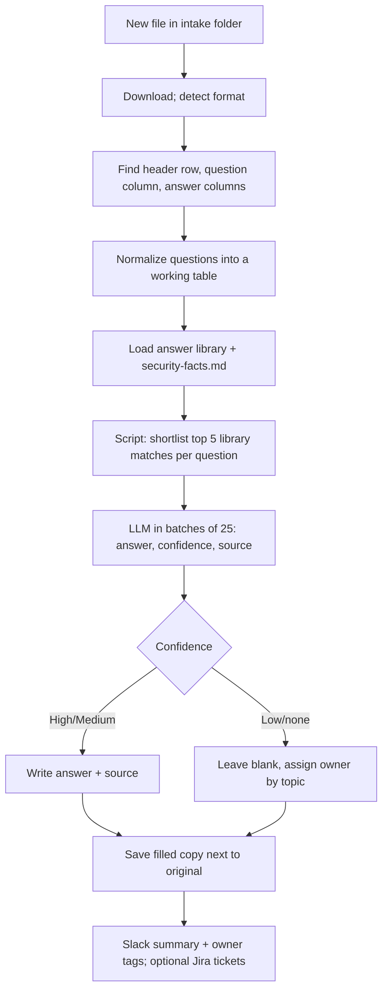

# Security questionnaire answerer

> Fills a customer's security questionnaire from your approved answers and security facts.
> Every answer gets a source and a confidence level. Questions it cannot answer go to a named
> owner. A person reviews the file before it goes back to the customer.

| | |
|---|---|
| Key | `security-questionnaire-answerer` |
| Sector | Security & Compliance (also sales, because it unblocks deals) |
| Card category | Security |
| Pattern | Inbound extractor (one file in, one filled file out) |
| Trigger | A new file in a Google Drive folder, a Slack mention with a file, or a manual run |
| Apps | Google Drive + Google Sheets (required), Notion or Confluence (optional), Slack (required), Jira (optional) |
| Score | 80 (Pain 5, Recurrence 4, Ease 4) |

## 1. The world this lives in

When a software company sells to a bigger company, the buyer's security team must approve the
vendor first. They send a **security questionnaire**: a spreadsheet (sometimes a web portal or
a Word file) with 50 to 800 questions such as "Do you encrypt data at rest?", "Do you have a
SOC 2 Type II report?", "How often do you run penetration tests?".

Until the questionnaire is done, the deal waits. Most questions are the same from customer to
customer, with different wording. The person who answers them (a security engineer, the CTO
at a startup, or a sales engineer) copies answers from the last questionnaire by hand.

Words you will see:

| Word | Meaning |
|---|---|
| Security questionnaire | A list of security questions a customer sends a vendor before buying. |
| Vendor / third-party risk | The buyer's process to check that a vendor is safe. |
| SIG | Standardized Information Gathering questionnaire, from Shared Assessments. SIG Lite has about 120-300 questions. |
| CAIQ | Consensus Assessments Initiative Questionnaire, from the Cloud Security Alliance. Yes/No/NA questions with notes. |
| HECVAT | A questionnaire used by universities in the US. |
| SOC 2 Type II | An independent audit report that a company's security controls worked over a period (often 12 months). |
| ISO 27001 | An international security certification. |
| Pen test | Penetration test: hired testers try to break into the system. |
| Trust center | A public or gated web page with the vendor's security documents. |
| Answer library | A list of approved question-answer pairs, reused across questionnaires. |
| NDA | Non-disclosure agreement; usually required before sharing a SOC 2 report. |

## 2. The problem today

How teams handle it now:

1. Sales forwards the spreadsheet to the security person with "the customer needs this by
   Friday".
2. The security person opens the last three filled questionnaires and copies answers row by
   row, adjusting the wording.
3. They chase engineers for the few new questions.
4. The file goes back days later. The deal waits.

Why it matters:

- A questionnaire takes 5-15 hours [Vv, Vanta], or 12-18 hours for 200 questions [Vv, Wolfia].
  One estimate gives 16 hours without an answer library and about 2.4 hours with one [Vv,
  quoted secondhand].
- Large buyers send many: security teams at enterprises report 150+ assessments a year [Vv].
- It blocks revenue. A late questionnaire delays a signature.

## 3. What the agent does

When a questionnaire file arrives:

1. Opens the file and finds the question column, the answer column(s), and any section names.
2. Reads your approved **answer library** (a Google Sheet) and **security facts** file.
3. For each question, finds the best matching approved answers and writes an answer in the
   format the questionnaire asks for (Yes/No/NA plus a comment, or free text).
4. Marks each answer with a confidence (High, Medium, Low) and the source it came from.
5. Leaves questions blank when there is no source, and assigns each one to an owner by topic.
6. Saves a filled copy next to the original and posts a summary in Slack.

After a person reviews the copy, a second step ("learn") adds the newly approved answers to
the answer library, so the next questionnaire is faster.

The agent never sends the file to the customer, never claims a certification that is not in
the facts file, and never invents numbers.

## 4. Who installs it and who benefits

- **Installs it:** the security or GRC lead, the CTO at a startup, or a sales engineer.
- **Benefits:** sales (faster deals) and the security person (hours back per questionnaire).

## 5. Apps it uses

| Connection key | Required | Composio options | What the agent does with it | Candidate actions | Policy |
|---|---|---|---|---|---|
| `files` | yes | `googledrive` | Watch the intake folder; download the questionnaire; upload the filled copy; read the answer library and facts. | `GOOGLEDRIVE_FIND_FILE`, `GOOGLEDRIVE_DOWNLOAD_FILE`, `GOOGLEDRIVE_UPLOAD_FILE`, `GOOGLEDRIVE_COPY_FILE` | allow reads and upload/copy; **deny** delete and share |
| `sheets` | yes | `googlesheets` | Read the answer library; read and write questionnaires that are Google Sheets. | `GOOGLESHEETS_GET_VALUES`, `GOOGLESHEETS_BATCH_UPDATE`, `GOOGLESHEETS_APPEND_VALUES` | allow |
| `policies` | no | `notion`, `confluence` | Read security policy pages for questions the library does not cover. | `NOTION_SEARCH_NOTION_PAGE`, `NOTION_FETCH_NOTION_BLOCK_CHILDREN`; Confluence search and get page | `allow_reads` |
| `chat` | yes | `slack` | Receive requests; post the summary; tag owners for blank answers. | `SLACK_SEND_MESSAGE`, `SLACK_DOWNLOAD_FILE` (candidate) | allow these; deny the rest |
| `tickets` | no | `jira` | Open one ticket per owner with their blank questions. | `JIRA_CREATE_ISSUE` | allow create only |

## 6. Setup: what the user provides

Required (one form):

| Field | Why | Default |
|---|---|---|
| Intake folder | Drive folder where sales drops questionnaires. | "Security questionnaires / Inbox" (the builder creates it if missing) |
| Answer library sheet | Your approved answers. | The builder creates an empty one with the columns below |
| Review channel | Where summaries and owner tags go. | `#security-reviews` |

Seed files:

- `security-facts.md`: the short list of facts the agent may state. The user fills it once:

```markdown
company_legal_name: Example Inc.
hosting: AWS, eu-central-1 and us-east-1
soc2: Type II, report period 2025-07-01 to 2026-06-30, auditor <name>; shared under NDA
iso27001: not certified
pen_test: annual, last completed 2026-05, by <firm>; summary letter available under NDA
encryption_at_rest: AES-256 (AWS KMS)
encryption_in_transit: TLS 1.2+
sso: SAML and OIDC supported on Enterprise plan
mfa: required for all employees
data_retention: customer data deleted within 30 days of contract end
subprocessors: <link to list>
incident_response: documented plan, tested annually
background_checks: all employees, where legal
owners:
  infrastructure: @alex
  application security: @jordan
  hr / people: @casey
  legal / privacy: @morgan
  default: @security-lead
```

- The answer library sheet, columns:

`id | question | answer | short_answer (Yes/No/NA) | topic | source | approved_by | approved_at`

The builder agent can seed it from one or two past filled questionnaires if the user shares
them: it extracts question-answer pairs and marks them `approved_by = import`.

## 7. Automations

| Key | Trigger | Detail | Message to the agent |
|---|---|---|---|
| `new-file` | subscription: Google Drive new file in folder (candidate `GOOGLEDRIVE_NEW_FILE_MATCHING_QUERY_TRIGGER`), `trigger_config` = intake folder | One run per new file. | "Fill the questionnaire file in inputs.event." + `"event": "$.event.attributes"` |
| `folder-sweep` | schedule `*/30 * * * 1-5` | Fallback: lists files in the intake folder without a filled copy. | "Fill any new questionnaire in the intake folder." |
| `learn` | manual (chat or Slack mention: "learn from <file>") | After review, adds approved new answers to the library. | — |

## 8. How one run works



Procedure for `AGENTS.md`:

1. Read `security-facts.md`. Read the whole answer library sheet.
2. Get the file. Support Google Sheets, `.xlsx`, and `.csv` in v1. For `.docx` or `.pdf`,
   extract the text, find numbered questions, and produce a Google Sheet with one question
   per row (say so in the summary). Skip password-protected files and say so.
3. Find the header row and columns with a script (`bash` + Python with `openpyxl` or `csv`):
   the column whose header looks like "Question" or "Control", and the answer columns
   ("Response", "Yes/No", "Comments"). If unsure, look at the first 10 data rows. Record the
   choice in the summary.
4. Build a working table: `row_number, section, question, answer_format`. Detect the format
   per column (a Yes/No/NA dropdown versus free text).
5. Shortlist: for each question, a script ranks library entries by word overlap (or a simple
   TF-IDF) and keeps the top 5. This keeps each LLM call small.
6. Answer in batches of 25 questions. For each question, give the LLM the question, the 5
   candidates, and the facts file. Ask for: `short_answer`, `answer` (in the questionnaire's
   format and in neutral, factual language), `confidence`, `source` (library id or fact key),
   and `topic`.
7. Apply the rules in section 9. Clear any answer that breaks them.
8. Copy the original file to "Security questionnaires / Drafts" as "<original name> — draft".
   Write the answers into the answer columns. Add three columns at the end: `AI confidence`,
   `AI source`, `Reviewer note`. Never change the questions.
9. Post the summary in Slack (section 10). Tag each owner with the count of their blank
   questions. If Jira is connected, open one ticket per owner with their question rows.
10. Report: "Filled 182 of 214 questions: 150 high, 32 medium, 32 blank."

Procedure, learn:

1. Read the reviewed draft. Rows where `Reviewer note` says "approved" or where the reviewer
   filled a blank answer are new knowledge.
2. Append them to the answer library with `approved_by` = the reviewer and today's date. Do
   not add duplicates (same question meaning as an existing entry); update the existing entry
   only if the reviewer wrote "replace".

## 9. Decision rules

| Rule | Detail |
|---|---|
| Source required | Every answer cites a library id or a fact key. No source → blank. |
| Facts win | If the library and the facts file disagree (for example a new pen test date), use the facts file and mark Medium. |
| No new claims | Never say "Yes" to a certification, a test, or a control that the facts file does not state. |
| No numbers from memory | Dates, counts, retention days, and key sizes come from facts or the library only. |
| High | A library answer for the same question meaning, still matching the facts. |
| Medium | Combined from two or more entries, or reworded for a different format. |
| Low | A guess from related material. Low answers are written only in the `Reviewer note` column as a suggestion, not in the answer column. |
| Sensitive | Questions that ask for the SOC 2 report, pen test report, or network diagrams → "Available under NDA via <trust center or contact>". |
| Owner | Blank questions get the owner for their topic from `security-facts.md`. |

## 10. Outputs

Filled copy: the customer's file, with answers in their columns, plus `AI confidence`,
`AI source`, and `Reviewer note` columns, saved in the Drafts folder.

Slack summary:

```
🛡️ Security questionnaire draft: "Acme vendor assessment (SIG Lite).xlsx"
214 questions · ✅ 150 high · 🟡 32 medium (please review) · ⬜ 32 blank
Draft: <Drive link> · Format: Yes/No/NA + comments (columns D and E)
Blank by owner: @alex 14 (infrastructure) · @jordan 9 (app security) · @morgan 6 (privacy) · @security-lead 3
Reminder: review every medium answer, then say "learn from this file".
```

## 11. Worked example

Sales drops "Acme vendor assessment (SIG Lite).xlsx" with 214 rows into the intake folder.
The agent finds questions in column C and answers in columns D (Yes/No/NA) and E (comments).
It shortlists library entries, answers in 9 batches, and writes the draft. Row 88 asks "Date
of last third-party penetration test?" The library says 2025-05, the facts file says 2026-05;
the agent writes 2026-05 with Medium confidence and source `pen_test`. Row 140 asks about
"customer-managed encryption keys"; there is no source, so it stays blank and goes to Alex.
The security lead reviews in 40 minutes instead of a day, sends the file, and runs "learn".

## 12. Guardrails

- The agent never sends or shares the file outside the company. Drive share actions are
  denied.
- It never edits the original file. It works on a copy.
- No answer without a source. Low-confidence text never appears in the answer column.
- It never attaches or quotes the SOC 2 report or pen test report.
- The answer library changes only through the `learn` step, after a human review.

## 13. Edge cases and failures

| Case | Handling |
|---|---|
| Multiple tabs | Process every tab that has a question column; list skipped tabs. |
| Merged cells and section headers | Treat rows without a question mark and with bold or merged cells as section names. |
| Questions with sub-parts ("a) ... b) ...") | Answer as one; note "Multi-part" in the reviewer note. |
| Web portal questionnaires (no file) | Out of scope in v1. The user exports to CSV or pastes questions into a sheet. |
| More than 800 questions | Process all, in batches; post progress after every 200. |
| Library is empty | Use only the facts file; expect many blanks; say so. |

## 14. State and de-duplication

The Drafts folder is the state: a file is done when a copy named "<name> — draft" exists. The
answer library is the long-term memory, kept in a sheet the team controls.

## 15. Compute and cost

A 200-question file needs about 8 batched LLM calls with small inputs (25 questions and 125
short candidates each), plus file reads and one write. A script does matching and file editing.
This is the heaviest template in the wave, and still a single pass with no loops.

## 16. How to test it

1. Create a small library (20 entries) and a facts file.
2. Make a test questionnaire: 30 questions, 20 rephrased from the library, 5 that need facts,
   5 that have no source.
3. `test_run` with "Fill the questionnaire file in inputs.event." Expect about 25 answered
   with sources and 5 blank with owners. Open the draft copy and check that the questions are
   unchanged.
4. Mark two blanks as answered and approved; run "learn from <file>". Expect two new library
   rows.
5. Turn on `new-file`; use Lightning "Test event", then drop a real file.

## 17. Success metrics

- Hours per questionnaire (ask the reviewer to note it).
- Share of questions answered at High confidence (goal: rises as the library grows).
- Days from questionnaire received to returned.

## 18. Package sketch

```json
{
  "schema_version": 1,
  "entry": "security-questionnaire-answerer",
  "agents": {
    "security-questionnaire-answerer": {
      "name": "Security questionnaire answerer",
      "description": "Fills security questionnaires from your approved answers, with a source and confidence per row.",
      "instructions": "./ai.agenta/agents/security-questionnaire-answerer/AGENTS.md",
      "setup": "./ai.agenta/agents/security-questionnaire-answerer/SETUP.md",
      "connections": [
        { "key": "files", "required": true, "purpose": "Read questionnaires and save filled drafts.",
          "options": [{ "kind": "gateway", "provider": "composio", "integration": "googledrive" }],
          "policy": { "permissions": { "default": "allow_reads", "tools": {
            "GOOGLEDRIVE_UPLOAD_FILE": "allow", "GOOGLEDRIVE_COPY_FILE": "allow" } } } },
        { "key": "sheets", "required": true, "purpose": "Read the answer library and write answers.",
          "options": [{ "kind": "gateway", "provider": "composio", "integration": "googlesheets" }],
          "policy": { "permissions": { "default": "allow", "tools": {} } } },
        { "key": "policies", "required": false, "purpose": "Read security policies for uncovered questions.",
          "options": [
            { "kind": "gateway", "provider": "composio", "integration": "notion" },
            { "kind": "gateway", "provider": "composio", "integration": "confluence" } ],
          "policy": { "permissions": { "default": "allow_reads", "tools": {} } } },
        { "key": "chat", "required": true, "purpose": "Post summaries and tag owners.",
          "options": [{ "kind": "gateway", "provider": "composio", "integration": "slack" }],
          "policy": { "permissions": { "default": "allow_reads", "tools": { "SLACK_SEND_MESSAGE": "allow" } } } },
        { "key": "tickets", "required": false, "purpose": "Open a ticket per owner for blank questions.",
          "options": [{ "kind": "gateway", "provider": "composio", "integration": "jira" }],
          "policy": { "permissions": { "default": "deny", "tools": { "JIRA_CREATE_ISSUE": "allow" } } } }
      ],
      "automations": [
        { "key": "new-file", "name": "New questionnaire file", "required": false,
          "trigger": { "type": "subscription", "connection": "files", "event_key": "GOOGLEDRIVE_NEW_FILE_MATCHING_QUERY_TRIGGER",
                       "trigger_config": { "folder_id": "<intake folder id>" } },
          "inputs_fields": { "messages": [{ "role": "user", "content": "Fill the questionnaire file in inputs.event." }],
                             "event": "$.event.attributes" } },
        { "key": "folder-sweep", "name": "Intake folder sweep", "required": false,
          "trigger": { "type": "schedule", "schedule": "*/30 * * * 1-5" },
          "inputs_fields": { "messages": [{ "role": "user", "content": "Fill any new questionnaire in the intake folder." }] } }
      ],
      "workspace": { "entries": [
        { "type": "file", "source": "./ai.agenta/agents/security-questionnaire-answerer/files/security-facts.md", "path": "security-facts.md" }
      ] }
    }
  }
}
```

## 19. Catalog card

- Summary: "Drafts security questionnaires from your approved answers."
- Trigger label: "New file" · description: "Runs when a questionnaire lands in your intake folder."
- Seed message: "Build an agent that fills security questionnaires dropped in our Drive
  folder using our answer library, marks confidence and source for each answer, and tags
  owners in Slack for anything it can't answer."
- Example: prompt "New file: Acme vendor assessment (SIG Lite).xlsx" → steps "Found 214
  questions", "Answered 182 with sources", "Tagged 4 owners for 32 blanks" → status
  "Awaiting review".

## 20. Open questions

- Does the agent runner have `openpyxl` (or can it install it) for `.xlsx` files? If not,
  convert `.xlsx` to a Google Sheet through Drive first.
- Confirm the Drive new-file trigger supports a folder filter.
- Should v2 read the company's trust center page as a source? It is one fixed URL, so it
  stays light.
